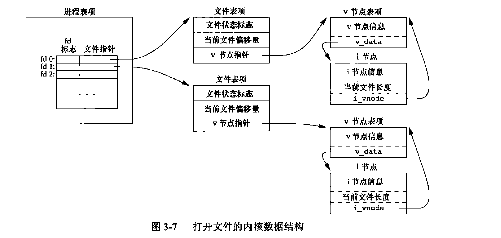
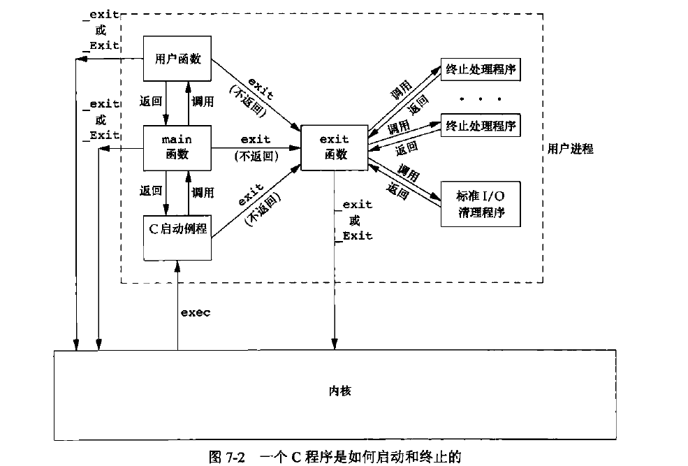
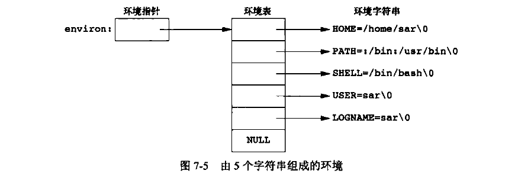

**note is not finished and not in consideration now**

[reference note from shichao-an](https://notes.shichao.io/apue/)

- [Introduction](#introduction)
  - [file and directory](#file-and-directory)
  - [Input and output](#input-and-output)
  - [programme and process](#programme-and-process)
  - [error handling](#error-handling)
  - [user ID](#user-id)
  - [signal](#signal)
- [UNIX standard](#unix-standard)
- [file I/O](#file-io)
- [file and dir](#file-and-dir)
  - [file types](#file-types)
  - [`chmod`, `fchmod`, and `fchmodat` Functions](#chmod-fchmod-and-fchmodat-functions)
  - [file system](#file-system)
- [Standard I/O Library](#standard-io-library)
  - [Standard Input, Standard Output, and Standard Error](#standard-input-standard-output-and-standard-error)
  - [Buffer](#buffer)
  - [stream](#stream)
  - [Read and Write Stream](#read-and-write-stream)
  - [每次一行 I/O](#每次一行-io)
  - [定位流](#定位流)
- [Process environment](#process-environment)
  - [Exit function](#exit-function)
  - [`atexit`](#atexit)
  - [environ](#environ)
  - [program memory layout](#program-memory-layout)
  - [allocate space](#allocate-space)
- [Process control](#process-control)
  - [`fork` Function](#fork-function)
  - [`vfork` Function](#vfork-function)
  - [`wait` and `waitpid` Functions](#wait-and-waitpid-functions)
- [Signal](#signal-1)

# Introduction

**Kernel** 控制计算机资源，提供程序运行环境。

## file and directory
Unix 文件系统是目录和文件的一种层次结构。起点是 root directory ("/")  

创建目录时会自动创建两个文件名：`.`（指向当前目录）、`..`（指向父目录）。  

值得一提的是在最高层次的根目录中，这两个文件名是一样的。  

书中的第一个代码例子值得学习  

```c
// 列出文件目录下的所有文件
#include "apue.h"
#include <dirent.h>

int
main(int argc, char *argv[])
{
    DIR    *dp;
    struct dirent  *dirp;

    if (argc != 2)
        err_quit("usage: ls directory_name");

    if ((dp = opendir(argv[1])) == NULL)
        err_sys("can't open %s", argv[1]);

    while ((dirp = readdir(dp)) != NULL)
        printf("%s\n", dirp->d_name);

    closedir(dp);
    exit(0);
}
```
## Input and output
重定向"<"和">".

书中代码例子值得细读.

```c
// 将标准输入复制到标准输出
#include "apue.h"

#define BUFFSIZE 4096

int
main(void)
{
    int n;
    char buf[BUFFSIZE];

    while ((n = read(STDIN_FILENO, buf, BUFFSIZE)) > 0)
        if (write(STDOUT_FILENO, buf, n) != n)
            err_sys("write error");

    if (n < 0)
        err_sys("read error");

    exit(0);
}
```

```c
// 上面的标准I/O 版本, 不过没有使用buf
#include "apue.h"

int
main(void)
{
    int c;

    while ((c = getc(stdin)) != EOF)
        if (putc(c, stdout) == EOF)
            err_sys("output error");

    if (ferror(stdin))
        err_sys("input error");

    exit(0);
}
```

## programme and process
**程序(program)** 是一个可执行文件  

**进程(process)** 是程序的执行实例  

每个进程有独特的ID (process ID)，可以使用`getpid()`获取PID。  

三个控制流函数`fork()`、`exec()`、`waitpid()`

书中的列子是将读取输入的字符串命令然后执行

```c
#include "apue.h"
#include <sys/wait.h>

int
main(void)
{
    char buf[MAXLINE]; /* from apue.h */
    pid_t pid;
    int status;

    printf("%s", /* print prompt (printf requires %% to print %) */
    while ((fgets(buf, MAXLINE, stdin) != NULL) {
        if (buf[strlen(buf) - 1] == '\n')
            buf[strlen(buf) - 1] = 0; /* replace newline with null */

        if ((pid = fork()) < 0) {
            err_sys("fork error");
        } else if (pid == 0) { /* child */
            execvp(buf, buf, (char *)0);
            err_ret("couldn't execute: %s", buf);
            exit(127);
        }

        /* parent */
        if ((pid = waitpid(pid, &status, 0)) < 0)
            err_sys("waitpid error");
        printf("%s ");
    }

    exit(0);
}
```

waitpid 函数返回子进程的终止状态(status变量)，例子中没有使用返回值  

## error handling
在以前只有进程的时候，使用`extern int errno;` 来定义errno  

UNIX系统默认错误码通常会返回一个负值，整型变量errno通常会被设定成相应的值  

在线程中，所以线程都指向同一个全局变量errno，是新定义为

```c
extern int *_errno_location(void);  
#define _errno (*_errno_location())  
```

strerror 函数并返回值是指向消息字符串的指针，errnum 通常是 errno 的值  

```c
#include <string.h>  
char* strerror(int errnum);  
```

`perror()`基于errno的值，在标准错误上产生一条出错信息，它首先输出msg的字符串，然后是一个冒号，一个空格, 接着是errno值的出错信息  

```c
#include <stdio.h>  
void perror(const char* msg);  
```

## user ID  
用户ID为0的用户为根用户(root)  

用户也可以属于一个组，于是有组ID  

相关函数：`getuid()`、`getgid()`  

## signal  
信号(signal)用于通知进程发生了某种情况。  

三种处理信号的方式  
1. 忽略信号，有些信号表示硬件异常  
2. 按优先级处理  
3. 提供捕获信号的函数，并按我们希望的次序处理信号  

SIGINT的系统默认动作是终止进程。  

书中的一个简单例子是定义了一个`sig-int(int)`函数, 不过只是简单的打印出 interrupt 字符串

```c
#include "apue.h"
#include <sys/wait.h>

static void sig_int(int);    /* our signal-catching function */

static void
sig_int(int signo)
{
    printf("interrupt\n");
}

int
main(void)
{
    char buf[MAXLINE];    /* from apue.h */
    pid_t pid;
    int status;

    if (signal(SIGINT, sig_int) == SIG_ERR)
        err_sys("signal error");

    printf("%% ");  /* print prompt */
    while (fgets(buf, MAXLINE, stdin) != NULL) {
        if (buf[strlen(buf) - 1] == '\n')
            buf[strlen(buf) - 1] = 0;    /* replace newline with null */

        if ((pid = fork()) < 0) {
            err_sys("fork error");
        } else if (pid == 0) {    /* child */
            execlp(buf, buf, (char *)0);
            err_ret("couldn't execute: %s", buf);
            exit(127);
        }

        /* parent */
        if ((pid = waitpid(pid, &status, 0)) < 0)
            err_sys("waitpid error");
        printf("%% ");
    }

    exit(0);
}
```

# UNIX standard
这一章不做笔记介绍

# file I/O
在 <unistd.h> 中定义了三个常量, 与文件描述符有关：
- `STDIN_FILENO` : 0
- `STDOUT_FILENO`: 1
- `STDERR_FILENO`: 2

---

`open` and `openat`

```c
#include <fcntl.h>
// 两函数的返回值：若成功，返回文件描述符；若出错，返回-1

int open(const char *path, int oflag, ... /* mode_t mode */);

int openat(int fd, const char *path, int oflag, ... /* mode_t mode */);
```

path 参数是要打开或创建文件的名字，oflag有多个选项

常见的oflag如下

> 前 5 个常量（`O_RDONLY`、`O_WRONLY`、`O_RDWR`、`O_EXEC`、`O_SEARCH`）必须且只能指定其中一个；其余为可选常量。

| 常量 | 说明 |
|------|------|
| `O_RDONLY` | 只读打开。 |
| `O_WRONLY` | 只写打开。 |
| `O_RDWR` | 读、写打开。 |
| `O_EXEC` | 只执行打开。 |
| `O_SEARCH` | 只搜索打开（应用于目录）。目前支持的操作系统较少。 |
| `O_APPEND` | 每次写时都追加到文件的尾部。 |
| `O_CLOEXEC` | 把 `FD_CLOEXEC` 设置为文件描述符标志。 |
| `O_CREAT` | 若文件不存在则创建。需同时指定第 3 个参数 `mode`。 |
| `O_DIRECTORY` | 如果 `path` 引用的不是目录，则出错。 |
| `O_EXCL` | 与 `O_CREAT` 同时使用，若文件已存在则出错。 |
| `O_NOCTTY` | 如果 `path` 引用终端设备，不将其分配为控制终端。 |
| `O_NOFOLLOW` | 如果 `path` 引用符号链接，则出错。 |
| `O_NONBLOCK` | 如果 `path` 引用 FIFO、块特殊文件或字符特殊文件，则使用非阻塞模式。 |

---

`create`, 返回值：若成功，返回为只写打开的文件描述符；若出错，返回-1

```c
#include <fcntl.h>

int creat(const char *path, mode_t mode);
```

等效于
```c
open(path, O_WRONLY | O_CREAT | O_TRUNC, mode)
```
- `create` 的缺点：以**只写**方式打开所创建的文件。

---

`close` 函数
```c
#include <unistd.h>
int close(int fd);
```
- **返回值**：成功返回 `0`，出错返回 `-1`。
- 关闭一个文件时，还会释放该进程在该文件上施加的**记录锁**。

**当前文件偏移量(current file offset)**是一个非负整数，用以度量从**文件开始处**计算的字节数。
- 通常，读、写操作从**当前文件偏移量**开始。
- 读写完成后，偏移量增加所读/写的字节数。

---

`lseek` 函数: 显式地设置文件的偏移量。
```c
#include <unistd.h>

off_t lseek(int fd, off_t offset, int whence);
```
- **返回值**：若成功，返回新的文件偏移量；若出错，返回 `-1`。

`offset` 参数的解释与 `whence` 有关
- 若 `whence` 是 `SEEK_SET`，则将该文件的偏移量设置为距文件开始处 `offset` 个字节。
- 若 `whence` 是 `SEEK_CUR`，则将该文件的偏移量设置为其当前值加 `offset`，`offset` 可为正或负。
- 若 `whence` 是 `SEEK_END`，则将该文件的偏移量设置为文件长度加 `offset`，`offset` 可正可负。

代码示例如下

```c
#include "apue.h"
int
main(void)
{
    if (lseek(STDIN_FILENO, 0, SEEK_CUR) == -1)
        printf("cannot seek\n");
    else
        printf("seek OK\n");
    exit(0);
}
```

输出如下

```console
$ ./a.out < /etc/passwd
seek OK
$ cat < /etc/passwd| ./a.out
cannot seek
$ ./a.out < /var/spool/cron/FIFO
cannot seek
```

---

`read` —— 从打开的文件中读取数据
```c
#include <unistd.h>
ssize_t read(int fd, void *buf, size_t count);
```

`write` —— 向打开的文件写数据
```c
#include <unistd.h>
ssize_t write(int fd, const void *buf, size_t count);
```
返回值：读到的字节数，若已到文件尾，返回 0；若出错，返回 -1

---

在介绍文件共享之前，先了解一下内核中一些 I/O 的数据结构。

内核使用 **3 种数据结构** 表示打开文件，它们之间的关系决定了在文件共享方面一个进程对另一个进程可能产生的影响。

1. 进程级文件描述符表
每个进程在进程表中都有一个记录项，其中包含一张**打开文件描述符表**（可视为一个矢量，每个描述符占用一项）。  
与每个文件描述符相关联的是：
- **a. 文件描述符标志**（如 `close_on_exec`）
- **b. 指向一个文件表项的指针**

2. 系统级文件表
内核为所有打开文件维护一张**文件表**。每个文件表项包含：
- **a. 文件状态标志**（读、写、同步、非阻塞等）
- **b. 当前文件偏移量**
- **c. 指向该文件 v 节点表项的指针**

3. v 节点（v-node）
每个打开文件（或设备）都有一个 **v 节点** 结构，包含：
- 文件类型
- 对此文件进行各种操作的函数指针
- 对于大多数文件，v 节点还包含该文件的 **i 节点（索引节点）**  
  - i 节点在打开文件时从磁盘读入内存，包含所有相关信息（如文件所有者、文件长度、指向磁盘数据块的指针等）

附图表加以理解



---

多进程写文件的数据竞争
- 多个进程同时写同一个文件可能存在**数据竞争**问题。
- 解决方案：使用 **`pread`** 和 **`pwrite`** 等扩展函数，它们允许**原子性定位并执行 I/O**。

调用 `pread` 相当于调用 `lseek` 后调用 `read`，但是 `pread` 又与这种顺序调用有下列重要区别。
- 调用 `pread` 时，无法中断其定位和读操作。
- 不更新当前文件偏移量。

调用 `pwrite` 相当于调用 `lseek` 后调用 `write`，但也与它们有类似的区别。

---

复制文件描述符
- **`dup`** 和 **`dup2`** 用于复制一个现有的文件描述符, `dup2`是一个原子操作
- 两函数的返回值：若成功，返回新的文件描述符；若出错，返回-1

```c
#include <unistd.h>

int dup(int fd);

int dup2(int fd, int fd2);
```

---

缓冲区一致性
- 当内核需要重用缓冲区时，会将所有**延迟写数据块**写入磁盘。
- **`sync`**、**`fsync`**、**`fdatasync`** 用于保证磁盘上文件系统与缓冲区内容的一致性。

```c
#include <unistd.h>

int fsync(int fd);

int fdatasync(int fd);

// 返回值：若成功，返回0；若出错，返回-1

void sync(void);
```

`sync`只是将所有修改过的块缓冲区排入写队列，然后就返回，它并不等待实际写磁盘操作结束。

通常，称为update的系统守护进程周期性地调用（一般每隔30秒）sync函数。这就保证了定期冲洗（flush）内核的块缓冲区。命令sync(1)也调用sync函数。

fsync函数只对由文件描述符fd指定的一个文件起作用，并且等待写磁盘操作结束才返回, fsync可用于数据库这样的应用程序，这种应用程序需要确保修改过的块立即写到磁盘上。

fdatasync函数类似于fsync，但它只影响文件的数据部分。而除数据外，fsync还会同步更新文件的属性。

# file and dir
[`restrict`](https://en.wikipedia.org/wiki/Restrict) keyword is used to tell the compiler which pointer references can be optimized, by indicating that the object to which the pointer refers is accessed in the function only via that pointer.


`stat`, `fstat`, `fstatat`, and `lstat` Functions

<small>[apue_stat.h](https://gist.github.com/shichao-an/dd0cdd90a54848ff3018)</small>

```c
#include <sys/stat.h>

int stat(const char *restrict pathname, struct stat *restrict buf);
int fstat(int fd, struct stat *buf);
int lstat(const char *restrict pathname, struct stat *restrict buf);
int fstatat(int fd, const char *restrict pathname, struct stat *restrict buf, int flag);

/* All four return: 0 if OK, −1 on error */
```
* `stat`: returns a structure of information about the named file
* `fstat`: returns a structure of information about the given file descriptor
* `lstat`: similar to `stat`, returns information about the symbolic link, not the file referenced by the symbolic link
* `fstatat`:  return the file statistics for a pathname relative to an open directory represented by the fd argument; the flag argument controls whether symbolic links are followed

元数据结构 stat 的大致结构如下：

```c
struct stat {
    mode_t st_mode;             /* file type & mode (permissions) */
    ino_t st_ino;               /* i-node number (serial number) */
    dev_t st_dev;               /* device number (file system) */
    dev_t st_rdev;              /* device number for special files */
    nlink_t st_nlink;           /* number of links */
    uid_t st_uid;               /* user ID of owner */
    gid_t st_gid;               /* group ID of owner */
    off_t st_size;              /* size in bytes, for regular files */
    struct timespec st_atime;   /* time of last access */
    struct timespec st_mtime;   /* time of last modification */
    struct timespec st_ctime;   /* time of last file status change */
    blksize_t st_blksize;       /* best I/O block size */
    blkcnt_t st_blocks;         /* number of disk blocks allocated */
};
```
## file types
UNIX/Linux 系统中的文件类型共有以下 7 种：

1. **普通文件**：包含文本或二进制数据，内核不解释内容（二进制可执行文件除外）。
2. **目录文件**：包含文件名及指向相关信息的指针，只有内核可直接写。
3. **块特殊文件**：提供对设备的带缓冲、固定长度访问（FreeBSD 已不再支持）。
4. **字符特殊文件**：提供对设备的不带缓冲、可变长度访问。
5. **FIFO（命名管道）**：用于进程间通信。
6. **套接字**：用于网络或本地进程间通信。
7. **符号链接**：指向另一个文件。

the following program prints the type of file for each command-line argument.
```c
#include "apue.h"

int
main(int argc, char *argv[])
{
	int			i;
	struct stat	buf;
	char		*ptr;

	for (i = 1; i < argc; i++) {
		printf("%s: ", argv[i]);
		if (lstat(argv[i], &buf) < 0) {
			err_ret("lstat error");
			continue;
		}
		if (S_ISREG(buf.st_mode))
			ptr = "regular";
		else if (S_ISDIR(buf.st_mode))
			ptr = "directory";
		else if (S_ISCHR(buf.st_mode))
			ptr = "character special";
		else if (S_ISBLK(buf.st_mode))
			ptr = "block special";
		else if (S_ISFIFO(buf.st_mode))
			ptr = "fifo";
		else if (S_ISLNK(buf.st_mode))
			ptr = "symbolic link";
		else if (S_ISSOCK(buf.st_mode))
			ptr = "socket";
		else
			ptr = "** unknown mode **";
		printf("%s\n", ptr);
	}
	exit(0);
}
```

## `chmod`, `fchmod`, and `fchmodat` Functions
```c
#include <sys/stat.h>

int chmod(const char *pathname, mode_t mode);
int fchmod(int fd, mode_t mode);
int fchmodat(int fd, const char *pathname, mode_t mode, int flag);

/* All three return: 0 if OK, −1 on error */
```

## file system
我们可以把一个磁盘分成一个或多个分区。每个分区包含一个文件系统节点是固定长度的记录项，它包含有关文件的大部分信息。

文件系统的结构大致如下


# Standard I/O Library
标准I/O库的操作围绕 **流(stream)** 展开。

Standard I/O file streams can be used with both single-byte and multibyte ("wide") character sets. 

A stream’s orientation determines whether the characters that are read and written are single byte or multibyte.

## Standard Input, Standard Output, and Standard Error
标准输入、标准输出和标准错误。这些流引用的文件与 STDIN_FILENO、STDOUT_FILENO 和 STDERR_FILENO 所引用的相同。

3 个标准 I/O 流通过预定义文件指针 `stdin`、`stdout` 和 `stderr` 加以引用, 定义在头文件`<stdio.h>`中。

## Buffer
标准 I/O 库提供缓冲的目的是尽可能减少使用 read 和 write 调用的次数.

标准 I/O 库提供了以下 3 种缓冲类型：

1. **全缓冲**  
   - 填满缓冲区后才进行实际 I/O 操作, 对于磁盘上的文件通常采用全缓冲。  
   - 第一次 I/O 时通过 `malloc` 分配缓冲区。  
   - “冲洗”指将缓冲区内容写到磁盘（可能部分填满）。  
2. **行缓冲**  
   - 遇到换行符时才执行 I/O 操作, 通常用于终端（如标准输入/输出）。  
   - 两个限制：  
     - 缓冲区固定长度，填满时即使无换行符也会执行 I/O。  
     - 当从不带缓冲的流或需要从内核读取数据的行缓冲流输入时，会冲洗所有行缓冲输出流。
3. **不带缓冲**  
   - 不进行字符缓冲，字符立即输出（例如通过 `write` 系统调用）.
   - 例如 `fputs` 写 15 个字符会直接输出到文件。

## stream
```c
#include <stdio.h>

FILE *fopen(const char *restrict pathname, const char *restrict type);
FILE *freopen(const char *restrict pathname,
              const char *restrict type,
              FILE *restrict fp);
FILE *fdopen(int fd, const char *type);

/* All three return: file pointer if OK, NULL on error */
```

`fclose` close the stream
```c
#include <stdio.h>

int fclose(FILE *fp);

/* Returns: 0 if OK, EOF on error */
```

## Read and Write Stream
```c
#include <stdio.h>

int getc(FILE *fp);
int fgetc(FILE *fp);
int getchar(void);

/* All three return: next character if OK, EOF on end of file or error */
```
## 每次一行 I/O
```c
#include <stdio.h>
char *fgets(char *restrict buf, int n, FILE *restrict fp);
char *gets(char *buf);

// 返回值：成功返回 buf，出错或到达文件末尾返回 NULL
```

相应的output函数如下：
```c
#include <stdio.h>
int fputs(const char *restrict str, FILE *restrict fp);
int puts(const char *str);

// 两个函数返回值：若成功，返回非负值；若出错，返回 EOF
```

`exit` 函数会冲洗任何未冲洗的数据，然后关闭所有的流。

## 定位流
```c
#include <stdio.h>
long ftell(FILE *fp); //返回值：若成功，返回当前文件位置指示；若出错，返回-1L
int fseek(FILE *fp, long offset, int whence); //返回值：若成功，返回0；若出错，返回-1
void rewind(FILE *fp);
```

# Process environment
## Exit function
`exit` 执行一些清理后返回内核，`_Exit` 和 `_exit`则直接进入内核。
```c
#include <stdlib.h>
void exit(int status);
void _Exit(int status);

#include <unistd.h>
void _exit(int status);
```

## `atexit`
这里的概念有点类似类的析构函数  

一个进程可以登记多至32个函数，这些函数由 `exit` 自动调用，早称为 **终止处理程序 (exit handler)**

使用`atexit`登记这些函数

```c
#include <stdlib.h>
int atexit(void (*func)(void)); //  返回值：若成功，返回0；若出错，返回非0
```

退出时，退出的过程大致如下：`exit` 首先调用各终止程序，然后关闭所有流。  



## environ
每个程序都接收到一张 **环境表** 。环境表是一个字符串指针数组  
```c
extern char **environ;
int main(int argc, char *argv[], char *envp[]);
```



## program memory layout


对于32位Intel x86处理器上的linux, 正文段从`0x0804800`单元开始，栈底在`0xc0000000`之下开始
## allocate space
- **malloc**：分配指定字节数的存储区，初始值不确定。  
- **calloc**：为指定数量、指定长度的对象分配存储空间，每一位初始化为 0。  
- **realloc**：增加或减少以前分配区的长度；增加时可能移动内容，新增区域的初始值不确定。
```c
#include <stdlib.h>

void *malloc(size_t size);
void *calloc(size_t nobj, size_t size);
void *realloc(void *ptr, size_t newsize);

void free(void *ptr);

// 3 个函数返回值：若成功，返回非空指针；若出错，返回 NULL
```


# Process control
每个进程都有一个非负整型表示的唯一进程 ID。

进程 ID 是可复用的。当一个进程终止后，其进程 ID 就成为复用的候选者。大多数 UNIX 系统实现 **延迟复用算法** ，使得赋予新建进程的 ID 不同于最近终止进程所使用的 ID。这防止了将新进程误认为是使用同一 ID 的某个已终止的先前进程。

系统中有一些专用进程. 
- ID 为 0 的进程通常是调度进程，常常被称为 **交换进程（swapper）**. 该进程是内核的一部分，它并不执行任何磁盘上的程序，因此也被称为系统进程。
- 进程 ID 1 通常是 init 进程，在自举过程结束时由内核调用。init 进程决不会终止。它是一个普通的用户进程（与交换进程不同，它不是内核中的系统进程），但是它以超级用户特权运行。

```c
include <unistd.h>

pid_t getpid(void);
/* Returns: process ID of calling process */

pid_t getppid(void);
/* Returns: parent process ID of calling process */

uid_t getuid(void);
/* Returns: real user ID of calling process */

uid_t geteuid(void);
/* Returns: effective user ID of calling process */

gid_t getgid(void);
/* Returns: real group ID of calling process */

gid_t getegid(void);
/* Returns: effective group ID of calling process */
```

None of these functions has an error to return

## `fork` Function
An existing process can create a new one by calling the `fork` function.

```c
#include <unistd.h>

pid_t fork(void);

/* Returns: 0 in child, process ID of child in parent, −1 on error */
```

*  The new process created by `fork` is called the **child process**. This function is called once but returns twice.
   *  `fork` returns child's process ID in parent
   *  `fork` returns 0 in child
* 子进程是父进程的副本。例如，子进程获得父进程数据空间、堆和栈的副本。注意，这是子进程所拥有的副本。父进程和子进程并不共享这些存储空间部分。父进程和子进程共享正文段
* Copy-on-write (COW) is used on modern implementations: a complete copy of the parent’s data, stack and heap is not performed. The shared regions are changed to read-only by the kernel. The kernel makes a copy of that piece of memory only if either process tries to modify these regions.

example code
```c
#include "apue.h"

int globvar = 6; /* external variable in initialized data */
char buf[] = "a write to stdout\n";

int
main(void)
{
    int var; /* automatic variable on the stack */
    pid_t pid;

    var = 88;
    if (write(STDOUT_FILENO, buf, sizeof(buf)-1) != sizeof(buf)-1)
        err_sys("write error");
    printf("before fork\n"); /* we don’t flush stdout */

    if ((pid = fork()) < 0) {
        err_sys("fork error");
    } else if (pid == 0) { /* child */
        globvar++; /* modify variables */
        var++;
    } else {
        sleep(2); /* parent */
    }

    printf("pid = %ld, glob = %d, var = %d\n", (long)getpid(), globvar,
           var);
    exit(0);
}
```

output as follow

```console
$ ./a.out
a write to stdout
before fork
pid = 430, glob = 7, var = 89 # child’s variables were changed
pid = 429, glob = 6, var = 88 # parent’s copy was not changed
$ ./a.out > temp.out
$ cat temp.out
a write to stdout
before fork
pid = 432, glob = 7, var = 89
before fork
pid = 431, glob = 6, var = 88
```


`fork` 有两种用法
1. 一个父进程希望复制自己，使父进程和子进程同时执行不同的代码段: 在网络服务进程中是常见的——父进程等待客户端的服务请求。当这种请求到达时，父进程调用 fork，使子进程处理此请求。父进程则继续等待下一个服务请求
2. 一个进程要执行一个不同的程序。这对 shell 是常见的情况: 在这种情况下，子进程从 fork 返回后立即调用 exec

## `vfork` Function
The function `vfork` has the same calling sequence and same return values as `fork`, but the semantics of the two functions differ.

`vfork` 函数用于创建一个新进程，而该新进程的目的是 exec 一个新程序

The `vfork` function creates the new process, just like `fork`, without copying the address space of the parent into the child, as the child won’t reference that address space; the child simply calls `exec` (or `exit`) right after the `vfork`. Instead, <u>the child runs in the address space of the parent until it calls either `exec` or `exit`.</u>

This optimization is more efficient on some implementations of the UNIX System, but leads to undefined results if the child:
* modifies any data (except the variable used to hold the return value from `vfork`)
* makes function calls
* returns without calling `exec` or `exit`

## `wait` and `waitpid` Functions
<u>When a process terminates, either normally or abnormally, the kernel notifies the parent by sending the `SIGCHLD` signal to the parent.</u>

A process that calls `wait` or `waitpid` can:
* Block, if all of its children are still running
* Return immediately with the termination status of a child, if a child has terminated and is waiting for its termination status to be fetched
* Return immediately with an error, if it doesn’t have any child processes
```c
#include <sys/wait.h>

pid_t wait(int *statloc);
pid_t waitpid(pid_t pid, int *statloc, int options);

/* Both return: process ID if OK, 0 (see later), or −1 on error */
```

检查 wait 和 waitpid 所返回的终止状态的宏
| 宏 | 说明 |
|---|---|
| WIFEXITED(status) | 若为正常终止子进程返回的状态，则为真。<br>对于这种情况可执行WEXITSTATUS(status)，获取子进程传送给exit或exit参数的8位 |
| WIFSIGNALED(status) | 若为异常终止子进程返回的状态，则为真（接到一个不捕捉的信号）。<br>对于这种情况，可执行WTERMSIG(status)，获取使子进程终止的信号编号。另外，有些实现（非Single UNIX Specification）定义宏WCOREDUMP(status)，若已产生终止进程的core文件，则它返回真 |
| WIFSTOPPED(status) | 若为当前暂停子进程的返回的状态，则为真。<br>对于这种情况，可执行WSTOPSIG(status)，获取使子进程暂停的信号编号 |
| WIFCONTINUED(status) | 若在作业控制暂停后已经继续的子进程返回了状态，则为真。<br>仅用于waitpid() |

对于 waitpid 函数中 pid 参数解释
- `pid == -1` 等待任一子进程。此种情况下，waitpid 与 wait 等效。
- `pid > 0` 等待进程 ID 与 pid 相等的子进程。
- `pid = 0` 等待组 ID 等于调用进程组 ID 的任一子进程。（9.4 节将说明进程组。）
- `pid < -1` 等待组 ID 等于 pid 绝对值的任一子进程。

# Signal
The simplest interface to the signal features of the UNIX System is the signal function
```c
#include <signal.h>

void (*signal(int signo, void (*func)(int)))(int);

/* Returns: previous disposition of signal (see following) if OK, SIG_ERR on error */
```
- `signal` 是一个函数，参数为 `(int signo, void (*func)(int))`。
- 它的返回值类型是 `void (*)(int)` —— 一个**函数指针**，指向参数为 `int`、返回值为 `void` 的函数。
- `int signo`：信号编号，如 `SIGINT`、`SIGTERM`。
- `void (*func)(int)`：也是一个函数指针，指向用户定义的信号处理函数（或 `SIG_IGN`、`SIG_DFL`）。

make it much simpler through the use of the following `typedef`:
```c
typedef void Sigfunc(int);

Sigfunc *signal(int, Sigfunc *);
```

这个声明是 **`signal` 函数**的标准原型，用于设置某个信号的处理方式。它看起来复杂，我们可以逐步拆解。

simple example 
```c
void my_handler(int sig) {
    printf("Caught signal %d\n", sig);
}

// 安装处理程序，保存旧的
void (*old)(int) = signal(SIGINT, my_handler);
if (old == SIG_ERR) {
    perror("signal");
}

// 恢复旧的处理程序
signal(SIGINT, old);
```

book example: recognize SIGUSR1 or SIGUSR2
```c
#include "apue.h"

static void sig_usr(int); /* one handler for both signals */

int
main(void)
{
    if (signal(SIGUSR1, sig_usr) == SIG_ERR)
        err_sys("can't catch SIGUSR1");
    if (signal(SIGUSR2, sig_usr) == SIG_ERR)
        err_sys("can't catch SIGUSR2");
    for (;;)
        pause();
}

static void
sig_usr(int signo)    /* argument is signal number */
{
    if (signo == SIGUSR1)
        printf("received SIGUSR1\n");
    else if (signo == SIGUSR2)
        printf("received SIGUSR2\n");
    else
        err_dump("received signal %d\n", signo);
}
```


