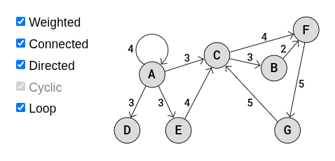
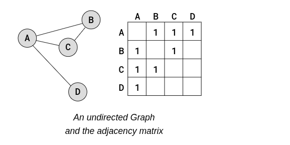
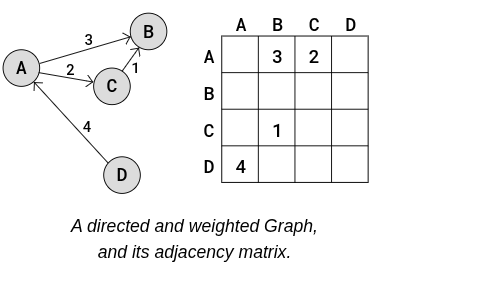
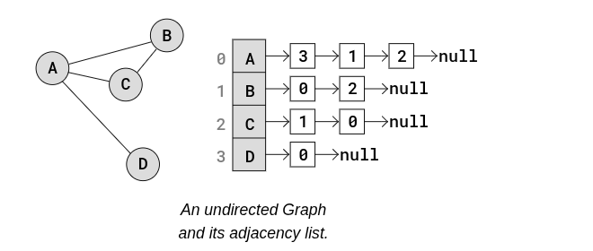
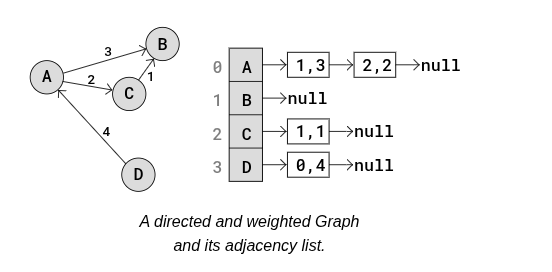

# Graph

Graphs generalize trees by allowing arbitrary connections and cycles.

The two core traversal techniques, DFS and BFS, work on graphs the same way
they do on trees, but you must now track visited nodes explicitly to
avoid infinite loops.

This stage covers the main graph problem types:

- counting connected components
- detecting cycles
- finding shortest paths in unweighted graphs
- topological ordering of dependencies.

Grids are also implicit graphs, where each cell is a node and adjacency is
defined by its four neighbors.
Most graph problems reduce to one of these patterns once you recognize the structure.

## Graph properties

below image frome [w3schools](https://www.w3schools.com/dsa/dsa_theory_graphs.php)



## Graph Representation









## 200. 岛屿数量

dfs

````cpp
int numIslands(vector<vector<char>> &grid)
{
    int m = grid.size(), n = grid[0].size();
    vector<vector<bool>> checked(m, vector<bool>(n, false));

    int ans = 0;
    constexpr array<pair<int, int>, 4> dirs = {{{1, 0}, {0, 1}, {-1, 0}, {0, -1}}};
    auto f = [&](this auto &&f, int i, int j) -> void {
        if(checked[i][j] || grid[i][j] == '0') return ;

        checked[i][j] = true;

        for(auto& p : dirs){
            int ni = i + p.first, nj = j + p.second;
            if(0 <= ni && ni < m && 0 <= nj && nj < n){
                f(ni, nj);
            }
        }
    };
    for (int i = 0; i < m; i++){
        for (int j = 0; j < n; j++){
            if(!checked[i][j] && grid[i][j] == '1'){
                f(i, j);
                ans++;
            }
        }
    }
    return ans;
}
````

优化：这里标记本质在抹除'1'，于是可以考虑原地修改`grid`，因为探索过的数据不会再探索，因此不会有冲突

````cpp
int numIslands(vector<vector<char>> &grid)
{
    int ans = 0;
    int m = grid.size(), n = grid[0].size();
    constexpr array<pair<int, int>, 4> dirs = {{{1, 0}, {0, 1}, {-1, 0}, {0, -1}}};

    auto f = [&](this auto &&f, int i, int j) -> void {
        if(grid[i][j] == '0') return;

        grid[i][j] = '0';

        for(auto& p : dirs){
            int ni = i + p.first, nj = j + p.second;
            if(0 <= ni && ni < m && 0 <= nj && nj < n){
                f(ni, nj);
            }
        }
    };

    for (int i = 0; i < m; i++){
        for (int j = 0; j < n; j++){
            if(grid[i][j] == '1'){
                f(i, j);
                ans++;
            }
        }
    }
    return ans;
}
````

[题解页](https://leetcode.cn/problems/number-of-islands/solutions)，思路都差不多: BFS, DFS，除了一些并查集的解法之类的。不过性能似乎差一些

## 133. 克隆图

debug了不少时间

````cpp
class Solution {
    unordered_map<Node*, Node*> Mapping;
    unordered_set<Node*> constructed;
public:
    Node* cloneGraph(Node* node) {
        if(node == nullptr) return nullptr;
        return cloneGraphHelper(node);
    }
    Node* cloneGraphHelper(Node* node){
        Node* cur;
        if(Mapping.count(node)) cur = Mapping[node];
        else{
            cur = new Node(node->val);
            Mapping[node] = cur;
        }

        for(Node* n : node->neighbors){

            Node* new_node;
            if(Mapping.count(n)){
                new_node = Mapping[n];
            } else {
                new_node = new Node(n->val);
                Mapping[n] = new_node;
            }
            cur->neighbors.push_back(new_node);
        }
        constructed.insert(node);
        for(auto& n : node->neighbors){
            if(!constructed.contains(n)){
                cloneGraphHelper(n);
            }
        }
        return cur;
    }
};
````

优化：这里其实可以让`hashMap`同时记录映射和已经构建的信息，无需额外的`hashSet`

````cpp
class Solution {
    unordered_map<Node*, Node*> Mapping;
public:
    Node* cloneGraph(Node* node) {
        if(node == nullptr) return nullptr;
        return dfs(node);
    }
    Node* dfs(Node* node){
        if(Mapping.count(node)) return Mapping[node];

        Node* cur = new Node(node->val);
        Mapping[node] = cur;
        for(Node* n : node->neighbors){
            cur->neighbors.push_back(dfs(n));
        }
        return cur;
    }
};
````

[题解页](https://leetcode.cn/problems/clone-graph/solutions)，题解就是BFS和DFS

## 417. 太平洋大西洋水流问题

败下阵来，这道题是逆向dfs，起点不明确，终点明确，这道题存在环，正向做很难

下面是ai代码题解：

````cpp
class Solution {
public:
    vector<vector<int>> pacificAtlantic(vector<vector<int>>& heights) {
        int m = heights.size(), n = heights[0].size();
        vector<vector<int>> ans;
        
        // 两个布尔数组，分别记录能流向太平洋和大西洋的格子
        vector<vector<bool>> pacific(m, vector<bool>(n, false));
        vector<vector<bool>> atlantic(m, vector<bool>(n, false));
        
        // 上下左右四个方向
        constexpr int dirs[4][2] = {{-1, 0}, {1, 0}, {0, -1}, {0, 1}};
        
        // DFS 函数：从 (i, j) 逆流而上
        auto dfs = [&](auto&& self, int i, int j, vector<vector<bool>>& visited) -> void {
            if (visited[i][j]) return; // 已经访问过，直接返回
            visited[i][j] = true;
            
            for (auto& dir : dirs) {
                int ni = i + dir[0], nj = j + dir[1];
                // 边界检查 && 只能往高处或等高处走（逆流）
                if (ni >= 0 && ni < m && nj >= 0 && nj < n && 
                    heights[ni][nj] >= heights[i][j]) {
                    self(self, ni, nj, visited);
                }
            }
        };

        // 1. 从左右边界出发（太平洋左边界，大西洋右边界）
        for (int i = 0; i < m; i++) {
            dfs(dfs, i, 0, pacific);    // 左边界接太平洋
            dfs(dfs, i, n - 1, atlantic); // 右边界接大西洋
        }
        
        // 2. 从上上边界出发（太平洋上边界，大西洋下边界）
        for (int j = 0; j < n; j++) {
            dfs(dfs, 0, j, pacific);    // 上边界接太平洋
            dfs(dfs, m - 1, j, atlantic); // 下边界接大西洋
        }
        
        // 3. 收集同时能流向两个大洋的格子
        for (int i = 0; i < m; i++) {
            for (int j = 0; j < n; j++) {
                if (pacific[i][j] && atlantic[i][j]) {
                    ans.push_back({i, j});
                }
            }
        }
        
        return ans;
    }
};
````

[题解页](https://leetcode.cn/problems/pacific-atlantic-water-flow/solutions)，题解也是逆向的dfs或者bfs

## 207. 课程表

败下阵来，dfs 标记法，这道题我一直想用两个`HashMap`来记录关系，结果发现不行

````cpp
class Solution {
    vector<vector<int>> graph;
    vector<int> visited; // 0:未访问, 1:正在访问, 2:已访问完毕

    bool dfs(int cur) {
        if (visited[cur] == 1)
            return false; // 遇到了正在访问的节点，说明有环
        if (visited[cur] == 2)
            return true; // 之前已经确认过这个节点安全了

        visited[cur] = 1; // 标记为正在访问
        for (int nextCourse : graph[cur]) {
            if (!dfs(nextCourse)) {
                return false;
            }
        }
        visited[cur] = 2; // 标记为已访问完毕（安全）
        return true;
    }

  public:
    bool canFinish(int numCourses, vector<vector<int>> &prerequisites) {
        graph.resize(numCourses);
        visited.assign(numCourses, 0);

        for (const auto &info : prerequisites) {
            graph[info[1]].push_back(info[0]);
        }

        for (int i = 0; i < numCourses; i++) {
            if (visited[i] == 0) {
                if (!dfs(i))
                    return false;
            }
        }
        return true;
    }
};
````

[题解页](https://leetcode.cn/problems/course-schedule/solutions)

## 127. 单词接龙

这道题对空间有要求，最短自然就使用BFS了，使用`visited`来记录访问过的下标

````cpp
class Solution {
    bool close(string &cur, string &other) {
        int cnt = 0;
        for (size_t i = 0; i < cur.size(); i++) {
            cnt += (cur[i] == other[i]) ? 0 : 1;
            if (cnt == 2)
                return false;
        }
        return true;
    }

  public:
    int ladderLength(string beginWord, string endWord,
                     vector<string> &wordList) {

        unordered_map<int, vector<int>> hp;
        unordered_set<int> visited;

        for (size_t i = 0; i < wordList.size(); i++) {
            string &cur = wordList[i];
            for (size_t j = i + 1; j < wordList.size(); j++) {
                if (i == j)
                    continue;
                if (close(cur, wordList[j])) {
                    hp[i].push_back(j);
                    hp[j].push_back(i);
                }
            }
        }

        queue<int> q;
        for (auto [i, word] : wordList | std::views::enumerate) {
            if (close(beginWord, wordList[i]))
                q.push(i);
        }

        int ans = 1;
        while (!q.empty()) {
            ans++;
            if (ans > wordList.size() + 2)
                return 0;
            size_t size = q.size();

            for (size_t i = 0; i < size; i++) {

                int cur = q.front();

                visited.insert(cur);

                if (wordList[cur] == endWord)
                    return ans;

                for (int i : hp[cur]) {
                    if (!visited.contains(i)) {
                        q.push(i);
                    }
                }
                q.pop();
            }
        }
        return 0;
    }
};
````

优化：使用`vector`而不是`HashMap`

````cpp
class Solution {
    bool close(string &cur, string &other) {
        int cnt = 0;
        for (size_t i = 0; i < cur.size(); i++) {
            cnt += (cur[i] == other[i]) ? 0 : 1;
            if (cnt == 2)
                return false;
        }
        return true;
    }

  public:
    int ladderLength(string beginWord, string endWord,
                     vector<string> &wordList) {

        int n = wordList.size();
        vector<vector<int>> nextWord(n, vector<int>());
        vector<bool> visited(n, false);

        for (size_t i = 0; i < wordList.size(); i++) {
            string &cur = wordList[i];
            for (size_t j = i + 1; j < wordList.size(); j++) {
                if (i == j)
                    continue;
                if (close(cur, wordList[j])) {
                    nextWord[i].push_back(j);
                    nextWord[j].push_back(i);
                }
            }
        }

        queue<int> q;
        for (auto [i, word] : wordList | std::views::enumerate) {
            if (close(beginWord, wordList[i]))
                q.push(i);
        }
        int ans = 1;
        while (!q.empty()) {
            ans++;
            if (ans > wordList.size() + 2)
                return 0;
            size_t size = q.size();

            for (size_t i = 0; i < size; i++) {

                int cur = q.front();

                visited[cur] = true;

                if (wordList[cur] == endWord)
                    return ans;

                for (int i : nextWord[cur]) {
                    if (!visited[i]) {
                        q.push(i);
                    }
                }
                q.pop();
            }
        }
        return 0;
    }
};
````

[题解页](https://leetcode.cn/problems/word-ladder/solutions)

看了题解，这里的优化是双向bfs + 通配符建图，我让deepseek c端做了一版，66ms左右

## 695. 岛屿的最大面积

dfs 练习题

````cpp
int maxAreaOfIsland(vector<vector<int>> &grid) {
    int m = grid.size(), n = grid[0].size();
    int ans = 0;
    constexpr int dir[4][2] = {{0, -1}, {0, 1}, {-1, 0}, {1, 0}};
    auto dfs = [&](this auto &&dfs, int i, int j) -> int {
        if (!grid[i][j])
            return 0;

        grid[i][j] = 0;
        int cur = 1;
        for (int d = 0; d < 4; d++) {
            int ni = i + dir[d][0], nj = j + dir[d][1];
            if (0 <= ni && ni < m && 0 <= nj && nj < n) {
                cur += dfs(ni, nj);
            }
        }
        ans = max(cur, ans);
        return cur;
    };
    for (int i = 0; i < m; i++) {
        for (int j = 0; j < n; j++) {
            if(grid[i][j]) dfs(i, j);
        }
    }
    return ans;
}
````

## 994. 腐烂的橘子

bfs 检查

````cpp
int orangesRotting(vector<vector<int>> &grid) {
    int m = grid.size(), n = grid[0].size();
    queue<pair<int, int>> q;

    bool has = false;
    for (int i = 0; i < m; i++) {
        for (int j = 0; j < n; j++) {
            if (grid[i][j]) {
                has = true;
            }
            if (grid[i][j] == 2) {
                q.push({i, j});
            }
        }
    }

    constexpr int dirs[4][2] = {{0, 1}, {0, -1}, {1, 0}, {-1, 0}};

    int ans = 0;
    while (!q.empty()) {
        int size = q.size();
        for (size_t i = 0; i < size; i++) {
            auto [curi, curj] = q.front();
            q.pop();
            for (int d = 0; d < 4; d++) {
                int ni = curi + dirs[d][0], nj = curj + dirs[d][1];
                if (0 <= ni && ni < m && 0 <= nj && nj < n) {
                    if (grid[ni][nj] == 1) {
                        q.push({ni, nj});
                        grid[ni][nj] = 2;
                    }
                }
            }
        }
        ans++;
    }

    for (int i = 0; i < m; i++)
        for (int j = 0; j < n; j++)
            if (grid[i][j] == 1)
                return -1;

    return has ? ans - 1 : 0;
}
````

优化：空间换时间，最后这里不需要遍历寻找`1`的存在，使用`HashSet`来记录

````cpp
#include <bits/stdc++.h>
using namespace std;
class Solution {
  public:
    int orangesRotting(vector<vector<int>> &grid) {
        ios::sync_with_stdio(false);
        cin.tie(nullptr);

        int m = grid.size(), n = grid[0].size();
        queue<pair<int, int>> q;
        unordered_set<int> exist1;

        bool has = false;
        for (int i = 0; i < m; i++) {
            for (int j = 0; j < n; j++) {
                if (grid[i][j]) {
                    has = true;
                }
                if (grid[i][j] == 2) {
                    q.push({i, j});
                }
                if (grid[i][j] == 1) {
                    exist1.insert(i * 10 + j);
                }
            }
        }

        constexpr int dirs[4][2] = {{0, 1}, {0, -1}, {1, 0}, {-1, 0}};

        int ans = 0;
        while (!q.empty()) {
            int size = q.size();
            for (size_t i = 0; i < size; i++) {
                auto [curi, curj] = q.front();
                q.pop();
                for (int d = 0; d < 4; d++) {
                    int ni = curi + dirs[d][0], nj = curj + dirs[d][1];
                    if (0 <= ni && ni < m && 0 <= nj && nj < n) {
                        if (grid[ni][nj] == 1) {
                            q.push({ni, nj});
                            exist1.erase(ni * 10 + nj);
                            grid[ni][nj] = 2;
                        }
                    }
                }
            }
            ans++;
        }

        if (!exist1.empty())
            return -1;
        return has ? ans - 1 : 0;
    }
};
````

[灵神题解](https://leetcode.cn/problems/rotting-oranges/solutions/2773461/duo-yuan-bfsfu-ti-dan-pythonjavacgojsrus-yfmh)，灵神的题解很简洁

## 课程表 II

和课程表I的思路差不多

````cpp
vector<int> findOrder(int numCourses, vector<vector<int>> &prerequisites) {
    vector<vector<int>> graph(numCourses, vector<int>());
    vector<int> visited(numCourses, 0);

    for (auto p : prerequisites) {
        graph[p[0]].push_back(p[1]);
    }

    vector<int> ans(numCourses);
    int idx = 0;
    auto dfs = [&](this auto &&dfs, int cur) -> bool {
        if (visited[cur] == 2)
            return true;

        if (visited[cur] == 1)
            return false;

        visited[cur] = 1;
        for (auto parent : graph[cur]) {
            if (!dfs(parent)) {
                return false;
            }
        }
        visited[cur] = 2;
        ans[idx++] = cur;
        return true;
    };

    for (int i = 0; i < numCourses; i++) {
        if (!dfs(i))
            return {};
    }
    return ans;
}
````

## 684. 冗余链接

败下阵来，这道题是并查集，第一次在LeetCode见

思路

1. 遍历每一条边 `(u, v)`。
2. 用并查集检查 `u` 和 `v` 是否已经连通。
3. 如果 `u` 和 `v` **不在**同一个集合中，说明这条边是合法的树边，将它们合并。
4. 如果 `u` 和 `v` **已经**在同一个集合中，说明它们之间已经有路径了，再加这条边就会形成环。因此，**这条边就是多余的边，直接返回。**

下面是deepseek c端解法：带路径压缩与按秩合并

````cpp
#include <vector>
#include <numeric>
using namespace std;

class Solution {
    // 并查集数组
    vector<int> parent;
    vector<int> rank;

    // 查找根节点（带路径压缩）
    int find(int x) {
        if (parent[x] != x) {
            parent[x] = find(parent[x]); // 路径上的节点直接连到根节点
        }
        return parent[x];
    }

    // 合并两个集合（按秩合并）
    // 返回 true 表示合并成功，false 表示已经在同一个集合中（发生冲突）
    bool unite(int x, int y) {
        int rootX = find(x);
        int rootY = find(y);
        
        if (rootX == rootY) {
            return false; // 已经连通，说明这条边是多余的
        }

        // 将深度较小的树接到深度较大的树下，保持树平衡
        if (rank[rootX] < rank[rootY]) {
            parent[rootX] = rootY;
        } else if (rank[rootX] > rank[rootY]) {
            parent[rootY] = rootX;
        } else {
            parent[rootY] = rootX;
            rank[rootX]++;
        }
        return true;
    }

public:
    vector<int> findRedundantConnection(vector<vector<int>>& edges) {
        int n = edges.size();
        parent.resize(n + 1);
        rank.resize(n + 1, 0);
        
        // 初始化并查集：每个节点的父节点是自己
        iota(parent.begin(), parent.end(), 0);

        // 遍历所有边
        for (const auto& edge : edges) {
            int u = edge[0], v = edge[1];
            // 如果合并失败（即 u 和 v 已经连通），这条边就是多余的
            if (!unite(u, v)) {
                return edge;
            }
        }
        return {};
    }
};
````

[题解页](https://leetcode.cn/problems/redundant-connection/solutions/)
