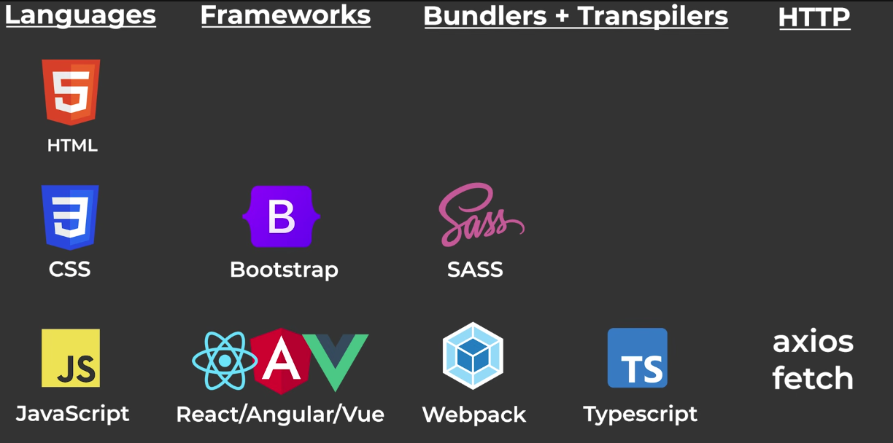
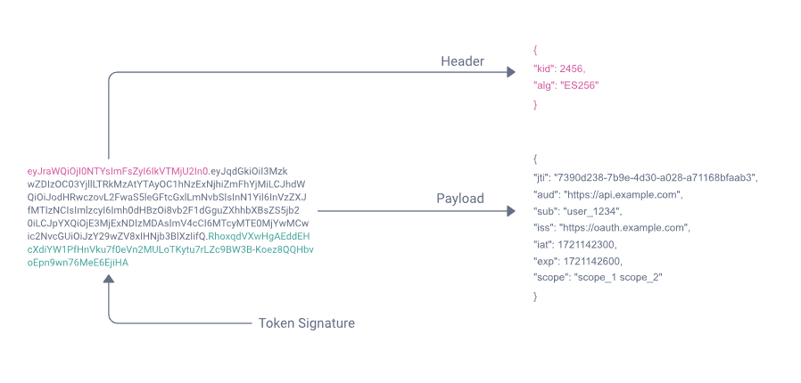
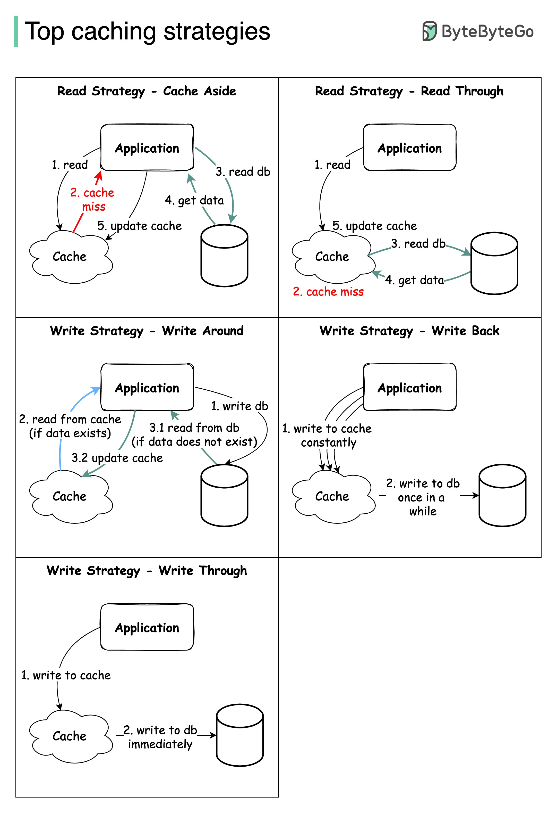
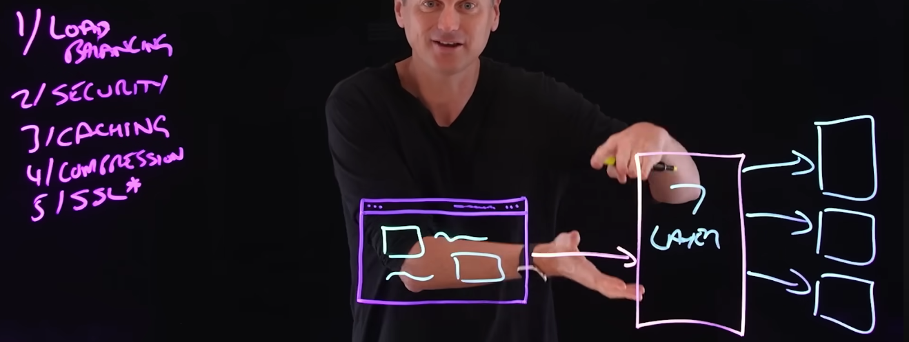
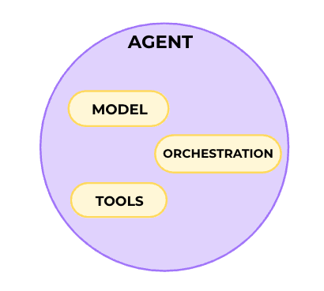
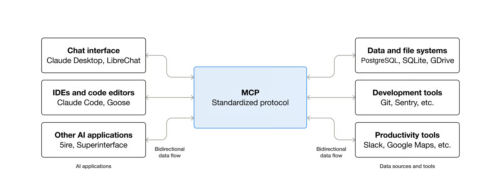
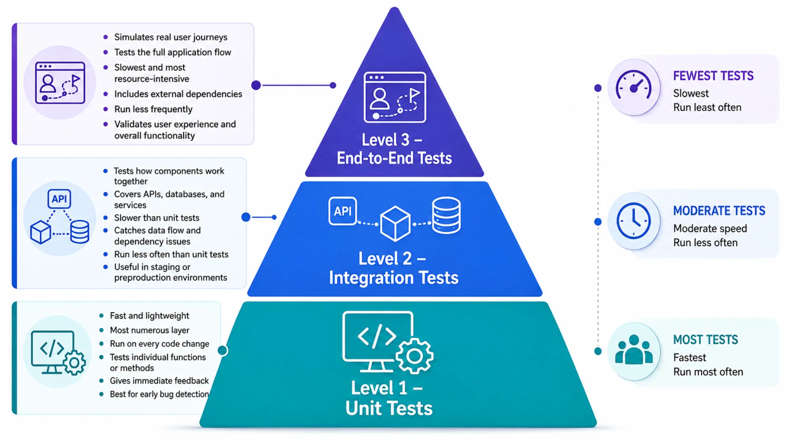
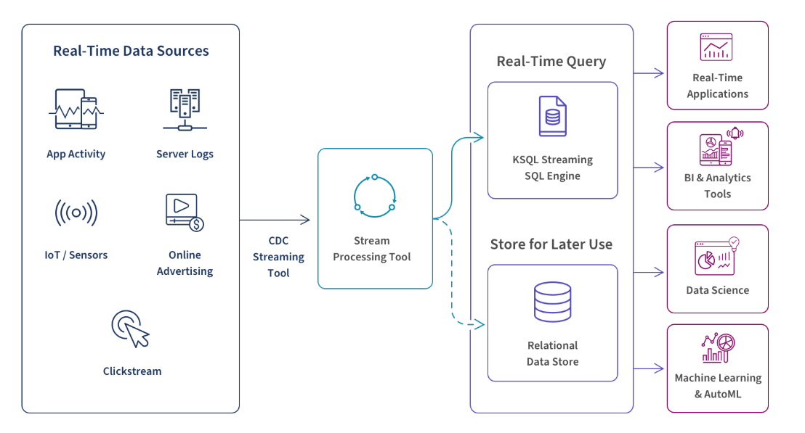

* [Backend Introduction](#backend-introduction)
  * [Core Components of Backend](#core-components-of-backend)
    * [Servers](#servers)
    * [Databases](#databases)
    * [API](#api)
  * [Importance of Backend Development](#importance-of-backend-development)
    * [Application Functionality and Performance](#application-functionality-and-performance)
  * [Backend vs Frontend Development](#backend-vs-frontend-development)
  * [Core Responsibilities of Backend Development](#core-responsibilities-of-backend-development)
    * [Handling User Requests](#handling-user-requests)
    * [Accessing and Managing Databases](#accessing-and-managing-databases)
    * [Implementing Business Logic](#implementing-business-logic)
    * [Ensuring System Security](#ensuring-system-security)
  * [Backend Tech Stack Overview](#backend-tech-stack-overview)
    * [Programming Languages](#programming-languages)
    * [Core Skill Areas](#core-skill-areas)
  * [Challenges and Best Practices in Backend Development](#challenges-and-best-practices-in-backend-development)
    * [Common Challenges](#common-challenges)
    * [Best Practices](#best-practices)
* [Internet Basis](#internet-basis)
* [Frontend Basis](#frontend-basis)
  * [Languages](#languages)
  * [Frameworks](#frameworks)
  * [Bundlers + Transpilers](#bundlers--transpilers)
  * [HTTP](#http)
* [Vesion Control System](#vesion-control-system)
* [Relationship Database](#relationship-database)
  * [Common Relational Database Products](#common-relational-database-products)
  * [N + 1 problem](#n--1-problem)
    * [example](#example)
* [Database Migration](#database-migration)
  * [Data Integrity is Maintained](#data-integrity-is-maintained)
    * [Schema Migration: The Blueprint Alterations](#schema-migration-the-blueprint-alterations)
    * [Data Migration: Moving The Furniture](#data-migration-moving-the-furniture)
    * [Advanced Database Migration Strategies](#advanced-database-migration-strategies)
  * [Managed Database Migration Solutions](#managed-database-migration-solutions)
  * [Automatic Migrations](#automatic-migrations)
* [APIs](#apis)
  * [API Introduction](#api-introduction)
    * [SOAP API](#soap-api)
    * [RPC API](#rpc-api)
    * [Websocket API](#websocket-api)
    * [REST API](#rest-api)
      * [protect REST API](#protect-rest-api)
    * [API Gateway](#api-gateway)
    * [GraphQL](#graphql)
  * [REST](#rest)
    * [The Six Constraints](#the-six-constraints)
      * [Uniform Interface](#uniform-interface)
      * [Stateless](#stateless)
      * [Cacheable](#cacheable)
      * [Client-Server](#client-server)
      * [Layered System](#layered-system)
      * [Code on Demand(optional)](#code-on-demandoptional)
    * [HTTP Methods tips](#http-methods-tips)
  * [gRPC](#grpc)
  * [GraphQL](#graphql-1)
  * [OpenAPI Specification](#openapi-specification)
  * [Authentication](#authentication)
    * [JWT](#jwt)
    * [OAuth](#oauth)
    * [Basic authentication](#basic-authentication)
    * [Cookie-Based Authentication](#cookie-based-authentication)
  * [Web Security](#web-security)
    * [1. MD5 (Message Digest 5)](#1-md5-message-digest-5)
      * [2. SHA (Secure Hash Algorithm)](#2-sha-secure-hash-algorithm)
      * [3. bcrypt](#3-bcrypt)
      * [4. scrypt](#4-scrypt)
    * [Comparsion Table](#comparsion-table)
  * [Other API security](#other-api-security)
    * [1. HTTPS (HyperText Transfer Protocol Secure)](#1-https-hypertext-transfer-protocol-secure)
    * [2. SSL/TLS (Secure Sockets Layer / Transport Layer Security)](#2-ssltls-secure-sockets-layer--transport-layer-security)
    * [3. CORS (Cross-Origin Resource Sharing)](#3-cors-cross-origin-resource-sharing)
    * [4. CSP (Content Security Policy)](#4-csp-content-security-policy)
    * [5. OWASP Risks](#5-owasp-risks)
    * [6. Server Security](#6-server-security)
* [Caching](#caching)
  * [Redis](#redis)
  * [Memcached](#memcached)
  * [Comparison](#comparison)
  * [HTTP Caching](#http-caching)
* [Web Server](#web-server)
* [AI in development](#ai-in-development)
  * [Agents vs models](#agents-vs-models)
  * [In-context learning](#in-context-learning)
  * [Embeddings](#embeddings)
  * [RAGs](#rags)
  * [AI-Assisted Coding](#ai-assisted-coding)
  * [Prompt](#prompt)
  * [Agents](#agents)
  * [Mcp](#mcp)
  * [Skills](#skills)
* [Integration Patterns](#integration-patterns)
  * [CI/CD](#cicd)
    * [CI: Continuous Integration](#ci-continuous-integration)
    * [CD: Continuous Delivery vs Continuous Deployment](#cd-continuous-delivery-vs-continuous-deployment)
    * [CI/CD importance](#cicd-importance)
    * [Common CI/CD tools](#common-cicd-tools)
* [Testing](#testing)
  * [Unit Testing](#unit-testing)
  * [Integration Testing](#integration-testing)
  * [Functional Testing](#functional-testing)
* [More about Database](#more-about-database)
  * [Transactions](#transactions)
* [Containerization](#containerization)
  * [Common container](#common-container)
* [Message Brokers](#message-brokers)
* [Architectural Patterns & Scailing Databases](#architectural-patterns--scailing-databases)
* [Real Time Data](#real-time-data)
  * [Real Time vs Batch](#real-time-vs-batch)
  * [Server Sent Events](#server-sent-events)
  * [WebSockets](#websockets)
  * [Long / Short Polling](#long--short-polling)
  * [Comparsion Table](#comparsion-table-1)

# Backend Introduction

Backend development focuses on the server-side logic of a web application, handling data storage, processing, and security.

* creating APIs
* managing databases
* implementing authentication
* authorization mechanisms
* ...

后端主要负责：

* **数据库交互**：处理数据的存储、检索和管理。这涉及查询数据库以获取信息，或根据用户交互或系统需求更新记录。
* **服务器逻辑**：执行服务端脚本并管理应用工作流。确保根据用户操作或计划任务，在正确的时间执行正确的流程。
* **应用工作流**：通过管理支撑前端的逻辑，确保应用顺畅运行。这包括处理用户请求、执行计算，并返回适当的响应。

## Core Components of Backend

每个部分在后端开发中都承担着特定作用，共同促进Web应用的整体功能与性能。下面我们将拆解核心元素——服务器、数据库和API——并了解它们如何协同工作，以支持流畅的交互。

### Servers

服务器在后端架构中至关重要。它们管理来自客户端的请求，进行处理，并返回适当的响应。这可能涉及查询数据库、执行服务端脚本，或与第三方服务集成。服务器充当用户与应用数据之间的桥梁，确保请求得到高效且安全的处理。

### Databases

数据库存储、组织和管理应用所使用的数据。它们确保数据易于访问，并可根据需要进行操作。以下是流行数据库：

* **MySQL**：广泛使用的关系型数据库管理系统，以可靠性和性能著称。
* **PostgreSQL**：高级关系型数据库，具备强大功能，如支持复杂查询。
* **MongoDB**：NoSQL文档数据库，以灵活性和快速迭代能力闻名。
* **Redis**：内存数据结构存储，可用作数据库、缓存和消息代理。

### API

**应用程序编程接口（API）** 是前端与后端之间的桥梁。它们支持无缝通信和数据交换，使用户体验保持动态和交互性。API定义了应用可用于通信的方法和数据格式，支持与其他服务和应用程序的集成。

例如，当顾客在网站上向购物车添加商品时，前端通过API将此操作发送到后端。后端随后更新库存和购物车详情，确保网站显示最新信息。这种通过API的交互保持了用户体验的流畅性和数据的准确性。

## Importance of Backend Development

在构建应用时，后端是真正承担繁重工作的地方。投资于坚实的后端对于性能、安全性和应对流量增长至关重要。

### Application Functionality and Performance

坚实的后端确保应用即使在用户负载很高的情况下也能高效运行。如果没有强大的后端作为基础，应用将难以处理复杂操作和大量用户请求。

## Backend vs Frontend Development

| 维度       | 前端（Frontend）            | 后端（Backend）              |
| -------- | ----------------------- | ------------------------ |
| **定义**   | 用户能看到和操作的一切             | 用户看不到的一切                 |
| **关注点**  | 表现层（Presentation Layer） | 数据访问层（Data Access Layer） |
| **运行位置** | 浏览器/客户端                 | 服务器                      |
| **核心职责** | 用户界面、交互、动画              | 业务逻辑、数据存储、API            |
| **主要技术** | HTML、CSS、JavaScript     | Java、Python、Node.js、数据库  |
| **性能关注** | 加载速度、渲染性能               | 吞吐量、延迟、可扩展性              |
| **安全关注** | XSS、CSRF                | SQL注入、认证授权、数据加密          |

## Core Responsibilities of Backend Development

### Handling User Requests

后端是系统的“收件员”和“调度中心”。

* 接收来自前端（浏览器、App、小程序）的HTTP请求
* 解析请求参数（如URL、Header、Body）
* 判断用户意图（是登录？查询？下单？）
* 调用相应逻辑进行处理

### Accessing and Managing Databases

数据库是系统的“中央仓库”，存储着所有核心数据。后端职责包括：

* 建立数据库连接
* 执行增删改查（CRUD）操作
* 保证数据一致性与完整性（事务管理）
* 优化查询性能（索引、分库分表）

**数据库类型**：

* **关系型数据库（SQL）** ：MySQL、PostgreSQL、Oracle（结构化数据）
* **非关系型数据库（NoSQL）** ：MongoDB（文档）、Redis（键值）、Elasticsearch（搜索）

### Implementing Business Logic

这是后端最核心的部分——将现实世界的规则转化为代码。

* 用户注册与登录（密码加密、验证码）
* 订单创建与支付流程
* 积分系统、优惠券发放
* 权限控制（RBAC、ABAC）
* 工作流引擎（审批、通知）

业务逻辑必须保证正确性、安全性、可扩展性。

### Ensuring System Security

后端是系统的“安全卫士”。常见安全措施包括：

| 安全领域 | 技术手段                      |
| ---- | ------------------------- |
| 身份认证 | JWT、OAuth2、Session/Cookie |
| 权限控制 | RBAC、ACL、API网关鉴权          |
| 数据安全 | HTTPS、数据加密（AES）、SQL注入防护   |
| 防攻击  | 防XSS、CSRF、DDoS、限流熔断       |

## Backend Tech Stack Overview

后端开发是一个“技术综合体”，需要掌握多种语言、框架与工具。

### Programming Languages

| 语言      | 特点             | 典型应用场景               |
| ------- | -------------- | -------------------- |
| Java    | 稳定、生态强大、企业级首选  | Spring Boot、微服务、金融系统 |
| Python  | 语法简洁、AI/数据分析强  | Django/Flask、爬虫、机器学习 |
| Node.js | JS全栈、高并发、I/O密集 | Express、Koa、实时应用     |
| Go      | 高性能、并发强、编译快    | 云原生、微服务、高并发系统        |
| PHP     | Web建站快、生态大     | WordPress、Laravel    |

### Core Skill Areas

后端工程师需要掌握的核心技能包括：

* **业务逻辑设计**
* **数据建模与数据库优化**
* **安全最佳实践**
* **API设计与集成**
* **测试与调试**
* **性能与可扩展性**
* **基础DevOps知识**（CI/CD、容器化、云平台）

## Challenges and Best Practices in Backend Development

### Common Challenges

* **性能与可扩展性的平衡**：随着用户增长，如何保持低延迟和高吞吐量
* **数据一致性与可用性的权衡**（CAP理论）
* **安全威胁的持续演进**
* **系统复杂度的管理**
* **调试与问题排查的难度**

### Best Practices

* **缓存策略**：在Nginx或Varnish代理后方部署，启用SSR和API缓存
* **错误处理**：对缺失或无效的请求参数抛出400 Bad Request，将技术错误转换为用户友好的消息
* **监控与可观测性**：实施健康监控、可用性监控、性能监控、安全监控
* **自动化**：CI/CD流水线、容器化部署、基础设施即代码
* **安全优先**：身份认证、权限控制、数据加密、防注入攻击

# Internet Basis

这一部分包括 internet 的介绍，tcp/ip等基础计算机网络知识，DNS，web server 的介绍，不做详细介绍

下面是一段 web browser 的简单介绍：

Web browsers interpret HTML, CSS, and JavaScript to render web pages.

Modern browsers use rendering engines (Blink, Gecko, WebKit) and JavaScript engines, offering many features:

* tabs
* bookmarks
* extensions
* security through sandboxing and HTTPS enforcement.

# Frontend Basis

这里重点介绍一下frontend的生态, html, css, JavaScript 不做具体介绍



## Languages

这是所有网页的基石，被称为前端三剑客：

* **HTML（超文本标记语言）**：网页的**骨架**。它定义了页面的结构和内容（如标题、段落、图片）。
* **CSS（层叠样式表）**：网页的**皮肤**。负责颜色、布局、字体、动画等视觉表现。
* **JavaScript（JS）**：网页的**肌肉与神经**。负责逻辑交互、响应点击、动态修改页面内容。

## Frameworks

这是为了提升开发效率，在基础语言之上建立的“脚手架”。

* **Bootstrap**：一个**CSS UI 框架**。它提供了现成的按钮、导航栏、栅格系统，能快速搭出响应式网页。
* **React / Angular / Vue**：当前前端世界的**三大主流 JS 框架**。用于构建复杂的“单页应用（SPA）”。它们引入了组件化开发，让代码更容易维护和复用。

## Bundlers + Transpilers

这是前端工程化的核心。因为现代前端代码越来越复杂，浏览器无法直接完美识别所有新语法，需要工具来“翻译”和“打包”。

* **SASS**：**CSS 预处理器**。它扩展了 CSS 的功能，允许使用变量、嵌套、函数等编程特性。写完后，需要\*\*转译（Transpile）\*\*回浏览器能看懂的普通 CSS。
* **TypeScript**：**JavaScript 的超集**。它为 JS 加上了静态类型检查。写起来更严谨，但在浏览器中需要**转译**成 JS。
* **Webpack**：**模块打包工具（Bundler）**。它把项目里散落的各种文件（JS、CSS、图片）全部打包、压缩、合并成浏览器可以直接加载的少量静态资源。

## HTTP

前端和后端沟通的“桥梁”。

* **fetch**：浏览器**原生内置**的 API。现代浏览器都支持，无需引入额外的库。
* **axios**：一个**流行的第三方 HTTP 客户端库**。它基于 Promise，语法更简洁，功能更强大（如拦截器、取消请求），是对 `fetch` 的封装和增强。

# Vesion Control System

refer to [git and github](./git_and_github.md)

# Relationship Database

Relational databases organize data into structured tables with **rows and columns**, using **SQL** for querying

## Common Relational Database Products

Each product below is one **kind of** relational database.

* **MySQL** — free and open source. It is a common choice for web applications.
* **MariaDB** — free and open source. It started as a copy of MySQL, so most MySQL code runs without a change.
* **PostgreSQL** — free and open source. It is strong on complex queries and on rich data types.
* **SQLite** — free and open source. It is small and embedded. It keeps the whole database in one file.
* **MS SQL** — a Microsoft product. The full name is Microsoft SQL Server. It is not free.
* **Oracle** — a commercial product. Large companies use it for big systems.

They differ in license, size, and features:

| Product    | License     | Typical use                          |
| ---------- | ----------- | ------------------------------------ |
| MySQL      | Open source | Web applications, read-heavy traffic |
| MariaDB    | Open source | Drop-in replacement for MySQL        |
| PostgreSQL | Open source | Complex queries, data integrity      |
| SQLite     | Open source | Embedded apps, mobile, local files   |
| MS SQL     | Commercial  | Windows servers, .NET applications   |
| Oracle     | Commercial  | Large enterprise systems             |

## N + 1 problem

a classic cause of performance issues in database-driven applications is the dreaded **N+1 query problem**.

[suggested youtude video here](https://www.youtube.com/watch?v=qPfAQY_RahA)

### example

假如我们有一个 PlanetScale 数据库, 其中包含一个 items 表和一个 categories 表

假设我们希望应用程序列出所有项目，包括它们所属的类别名称 。一种直接的方法是，首先查询类别列表，然后遍历每个类别，查询每个类别中的项目。

**categories table:**

| id | name    |
| :- | :------ |
| 1  | Produce |
| 2  | Deli    |
| 3  | Dairy   |

**items table:**

| id | name   | category_id |
| :- | :----- | :---------- |
| 1  | Apples | 1           |
| 2  | Cheese | 2           |
| 3  | Bread  | NULL        |

```php
// first query
<?php
    $dbh = new Dbh();
    $conn = $dbh->connect();
    $sql = "SELECT * FROM categories;";
    $stmt = $conn->prepare($sql);
    $stmt->execute();

// second query
<?php
while ($row = $stmt->fetch()) {
    // Show category name
    echo $row['name'];

    // Now query for the items for this category
    $sql = "
        SELECT id, name FROM items
        WHERE category_id = :category_id
        ORDER BY name;
    ";

    $stmt2 = $conn->prepare($sql);
    $stmt2->bindParam(':category_id', $row['id']);
    $stmt2->execute();
    $rowCount += $stmt2->rowCount();

    while ($row2 = $stmt2->fetch()) {
        // Show item ID and name
        echo $row2['id'];
        echo $row2['name'];
    }
}
```

这种查询执行方式通常被称为 $N + 1$ 查询，因为它不是在单个查询中完成所有工作，而是先运行一个查询来获取类别列表，然后对每 $N$ 个类别运行另一个查询。因此得名 $N + 1$ 查询

在这个例子里面使用`LEFT JOIN`是有效的解决方案

```php
<?php
    $dbh = new Dbh();
    $conn = $dbh->connect();
    // Record the time before the query is executed
    $timeStart = microtime(true);

    $sql = "
        SELECT
            c.id AS category_id,
            c.name AS category_name,
            i.id AS item_id,
            i.name AS item_name
        FROM categories c
        LEFT JOIN items i ON c.id = i.category_id
        ORDER BY c.name, i.name;
    ";
    $stmt = $conn->prepare($sql);

    $stmt->execute();
    $rowCount = $stmt->rowCount();

    $lastCategoryId = null;

    while ($row = $stmt->fetch()) {
        // Render the heading for each category if this category is new
        if ($row['category_id'] != $lastCategoryId) {
            echo $row['category_name'];
        }

        // Display the row for each item
        if (!is_null($row['item_id'])) {
            echo $row['item_id'];
            echo $row['item_name'];
        }

        $lastCategoryId = $row['category_id'];
    }
```

# Database Migration

[good video with code example here](https://www.youtube.com/watch?v=mMsZPZKNc4g)

Database migrations are essential as they involve adapting and evolving databases to meet changing needs and demands

Planning your migration ensures that:

1. Data Integrity is Maintained
2. Efficiency
3. Smooth Transition

## Data Integrity is Maintained

there are two types of database migration

* Schema Migration
* Data Migration

### Schema Migration: The Blueprint Alterations

A database schema is like the blueprint of a house, showing the structure and layout of the database. Schema migrations are changes made to this "blueprint" to meet new needs.

For instance, removing a table column is like taking down a wall to open up space, and adding a new table is like building an extra floor.

Schema migrations can include:

1. **Adding, altering, or dropping tables**
2. **Changing data types of columns**
3. **Introducing or changing indices**: This is like optimizing the flow and accessibility within your house, ensuring you can fetch what you need faster.

### Data Migration: Moving The Furniture

Data Migration *deals directly with the data* in the database — the actual information, not just its structure.

Use cases:

* Transferring data from one database system to another
* Upgrading a database version
* Changing the way data is stored and accessed

### Advanced Database Migration Strategies

1. Altering Fields
2. Adding Unique Constraints
3. Handling Relationships

## Managed Database Migration Solutions

数据迁移有时就像搬家一样。你不会把所有家当都背在背上，对吧？相反，你很可能会雇佣搬家公司。在数据库领域，这种服务就是托管数据库迁移解决方案。

它们简化、自动化并管理繁重的迁移工作，确保平稳过渡，并将出错的可能性降至最低。

pros using the managed database migration solutions:

* Efficiency
* Reduced Risk
* Cost-Effective
* Expertise on Demand

下面是一些热门的托管迁移服务:

* AWS Database Migration Service (DMS)
* Google Cloud's Database Migration Service
* Azure Database Migration Service

## Automatic Migrations

随着代码库的演进，数据库也必须及时调整以保持同步。自动迁移在此环境中发挥着至关重要的作用，它提供了一种机制，能够高效地将代码变更与数据库更新保持一致。

市面上有很多数据库迁移工具。

* **Alembic**：Python 生态，配合 SQLAlchemy，适合用 Python 代码定义模型并自动生成迁移。
* **Flyway**：JVM 生态，SQL 优先，适合多语言、多数据库。
* **Django Migrations**：Django 框架自带，和 ORM 深度集成。

无论哪种工具，核心思想都一样：

1. 每个迁移是一个版本。
2. 迁移按顺序应用。
3. 数据库里有一张表记录已应用的版本。
4. 支持升级和回滚。
5. 保证团队和生产环境数据库结构一致。

核心都是在用脚本的形式，管理数据库的版本历史。

Alembic 和 Django 还支持脚本代码自动生成

# APIs

API (Application Programming Interface) defines rules and protocols for software applications to communicate.

Provides standardized access to functionalities without understanding internal workings. Includes:

* endpoints
* request methods (GET, POST, PUT)
* data formats (JSON, XML).

## API Introduction

API 有四种不同的工作方式

### SOAP API

这些 API 使用简单对象访问协议。客户端和服务器使用 XML 交换消息。这是一个不太灵活的 API，它在过去比较流行。

### RPC API

这些 API 称为远程过程调用。客户端在服务器上完成函数（或过程），而服务器将输出发回客户端。

### Websocket API

[Websocket API](https://docs.aws.amazon.com/apigateway/latest/developerguide/apigateway-websocket-api-overview.html) 是另外一种使用 JSON 对象传递数据的现代 Web API 开发方式。WebSocket API 支持在客户端应用程序和服务器之间进行双向通信。服务器可以向连接的客户端发送回调消息，使其比 REST API 更高效。

### REST API

这些是如今最流行、最灵活的 Web API。客户端以数据形式向服务器发送请求。服务器使用该客户端输入来开始执行内部函数，并将输出数据返回到客户端。

REST 代表表现层状态转换。REST 定义了一组函数，如 GET、PUT、DELETE 等，客户端可以使用这些函数来访问服务器数据。客户端和服务器使用 HTTP 交换数据。

REST API 的主要特点是**无状态**。

无状态意味着服务器不会保存各种请求之间的客户端数据，客户端对服务器的请求类似于您在浏览器中键入的、用来访问网站的 URL。来自服务器的响应是纯数据，不包括典型的 Web 页面图形化渲染。

#### protect REST API

必须通过适当的身份验证和监控为所有 API 提供保护。保护 REST API 的两种主要方法包括：

1. 身份验证令牌
2. API 密钥

### API Gateway

API Gateway 是一种 API 管理工具，适用于使用各种后端服务的企业客户端。

API Gateway 通常用于处理适用于所有 API 调用的常见任务，如用户身份验证、统计数据和速率管理。

### GraphQL

GraphQL 是一种专门为 API 开发的查询语言。

作为 REST 的替代方案，GraphQL 为前端开发人员提供通过单一 GraphQL 端点查询多个数据库、微服务和 API 的功能。

## REST

[good introduction video here](https://www.youtube.com/watch?v=0oXYLzuucwE)

REST 是一组**架构约束**，而不是协议或标准。API 开发人员可以通过多种方式实现 REST。

the caller (or client):

* Makes an HTTP request to a URL...
  * Using one of the standard HTTP methods (GET, PUT, POST, PATCH, DELETE, etc.)...
  * With some content (usually JSON) in the body...
* And waits for a response, which:
  * Indicates status via an HTTP response code
  * And usually has more JSON in the body.

### The Six Constraints

#### Uniform Interface

统一接口约束定义了客户端和服务器之间的接口。它简化并解耦了架构，使每个部分都能独立演进。

统一接口有四个指导原则:

* Resource-Based: 请求中使用 URI 作为资源标识符来识别各个资源。资源本身在概念上与返回给客户端的表示形式是分离的。例如，服务器不会发送其数据库，而是发送一些 HTML、XML 或 JSON 数据，这些数据代表一些数据库记录
* Manipulation of Resources Through Representations: 当客户端持有资源的表示形式（包括附加的任何元数据）时，它就拥有足够的信息来修改或删除服务器上的资源，前提是它拥有相应的权限。
* Self-descriptive Messages: 每条消息都包含足够的信息来描述如何处理该消息。
* Hypermedia as the Engine of Application State (HATEOAS): 客户端通过请求体内容、查询字符串参数、请求头和请求的 URI（资源名称）传递状态。服务通过响应体内容、响应代码和响应头向客户端传递状态。这在技术上被称为超媒体（或超文本中的超链接）。

#### Stateless

REST 是 REpresentational State Transfer（表述性状态转移）的缩写，其核心在于无状态性。本质上，这意味着处理请求所需的状态都包含在请求本身中

#### Cacheable

与万维网类似，客户端可以缓存响应。因此，响应必须以隐式或显式的方式定义自身是否可缓存，以防止客户端在响应后续请求时重复使用过时或不适用的数据。

#### Client-Server

统一的接口将客户端与服务器分离。只要接口不变，服务器和客户端就可以独立替换和开发。

#### Layered System

客户端通常无法分辨它是直接连接到终端服务器，还是连接到中间服务器。中间服务器可以通过实现负载均衡和提供共享缓存来提高系统可扩展性。此外，各层还可以强制执行安全策略。

#### Code on Demand(optional)

服务器可以通过向客户端传输可执行的逻辑，临时扩展或自定义客户端的功能。例如，可以传输编译后的组件（如 Java 小程序）和客户端脚本（如 JavaScript）。

### HTTP Methods tips

通常，五种主要的 HTTP 方法用法如下：

| 方法     | 描述                                                    |
| :----- | :---------------------------------------------------- |
| GET    | 读取特定资源（通过标识符）或资源集合。                                   |
| PUT    | 替换特定资源（通过标识符）或资源集合。如果事先知道资源标识符，也可用于创建特定资源。            |
| PATCH  | 更新特定资源（通过标识符）或资源集合。在某种程度上，可以将其视为“部分更新”，而不是 PUT 执行的替换。 |
| DELETE | 通过标识符移除/删除特定资源。                                       |
| POST   | 创建新资源。也是不适合其他类别的操作的通用动词。                              |

Use HTTP Response Codes to Indicate Status

关于“十大”HTTP 响应状态码的建议用法如下：

| 状态码                       | 描述                                                                                                                                                                    |
| :------------------------ | :-------------------------------------------------------------------------------------------------------------------------------------------------------------------- |
| 200 OK                    | 通用成功状态码。这是最常见的代码，用于表示成功。                                                                                                                                              |
| 201 CREATED               | 成功创建（通过 POST 或 PUT 实现）。在 POST 时，设置 Location 标头以包含指向新创建资源的链接。响应正文内容可能存在，也可能不存在。                                                                                        |
| 204 NO CONTENT            | 表示成功，但响应正文中没有任何内容，通常用于 DELETE 和 PUT 操作。                                                                                                                               |
| 400 BAD REQUEST           | 当满足请求会导致无效状态时的通用错误。域验证错误、数据缺失等是一些示例。                                                                                                                                  |
| 401 UNAUTHORIZED          | 缺少或无效身份验证令牌时的错误代码响应。                                                                                                                                                  |
| 403 FORBIDDEN             | 当用户无权执行操作，或资源因某种原因（例如时间限制等）不可用时返回的错误代码。                                                                                                                               |
| 404 NOT FOUND             | 当请求的资源未找到时使用，无论是不存在，还是出于安全原因服务希望掩盖 401 或 403 错误。                                                                                                                      |
| 405 METHOD NOT ALLOWED    | 用于指示请求的 URL 存在，但请求的 HTTP 方法不适用。例如，POST /users/12345，其中 API 不支持以这种方式（使用提供的 ID）创建资源。返回 405 时必须设置 Allow HTTP 标头，以指示支持的 HTTP 方法。在前一种情况下，标头看起来像 "Allow: GET, PUT, DELETE"。 |
| 409 CONFLICT              | 当满足请求会导致资源冲突时。重复条目（例如尝试创建两个信息相同的客户），以及在不支持级联删除时删除根对象，是两个示例。                                                                                                           |
| 500 INTERNAL SERVER ERROR | **切勿故意返回此错误。** 当服务器端抛出异常时的通用兜底错误。仅用于调用方无法从其端解决的错误。                                                                                                                    |

下表总结了主要 HTTP 方法与资源 URI 组合的推荐返回值：

| 方法     | CRUD                   | 整个集合（例如 /customers）                                     | 特定项目（例如 /customers/{id}）                     |
| :----- | :--------------------- | :------------------------------------------------------ | :------------------------------------------- |
| POST   | 创建 (Create)            | 201（已创建），'Location' 标头包含指向 /customers/{id} 的链接（包含新 ID）。 | 如果资源已存在，则返回 404（未找到），409（冲突）。                |
| GET    | 读取/检索 (Read/Retrieve)  | 200（成功），客户列表。使用分页、排序和筛选来浏览大列表。                          | 200（成功），单个客户。如果 ID 未找到或无效，则返回 404（未找到）。      |
| PUT    | 更新/替换 (Update/Replace) | 405（方法不允许），除非你想更新/替换整个集合中的每一个资源。                        | 200（成功）或 204（无内容）。如果 ID 未找到或无效，则返回 404（未找到）。 |
| PATCH  | 更新/修改 (Update/Modify)  | 405（方法不允许），除非你想修改集合本身。如果对整个集合进行操作，这是可能的。                | 200（成功）或 204（无内容）。如果 ID 未找到或无效，则返回 404（未找到）。 |
| DELETE | 删除 (Delete)            | 405（方法不允许），除非你想删除整个集合——这通常不是我们想要的。                      | 200（成功）或 204（无内容）。如果 ID 未找到或无效，则返回 404（未找到）。 |

## gRPC

gRPC is a high-performance, open-source RPC (Remote Procedure Call) framework with greate features:

* Protocol Buffers
* Streaming
* HTTP/2
* Channels

在system_design.md里面有简单介绍

## GraphQL

GraphQL is Facebook's query language for APIs, allowing clients to request exactly the data they need.

It uses a single endpoint with schema-defined data structure, reducing over-fetching and under-fetching.

More flexible than REST for complex applications with diverse platform needs.

GraphQL 是 REST 的一种替代方案

| 对比维度               | RESTful API                                               | GraphQL                                                          |
| :----------------- | :-------------------------------------------------------- | :--------------------------------------------------------------- |
| **端点 (Endpoints)** | **多个端点**。每个资源有独立的 URL（如 `/users`, `/orders`）。             | **通常只有一个端点**（如 `/graphql`）。所有请求都发往这里。                            |
| **数据获取**           | **服务端决定返回什么**。客户端请求某个资源，服务端返回该资源的完整结构（容易导致“过度获取”或“获取不足”）。 | **客户端决定返回什么**。客户端精确指定需要哪些字段，服务端只返回这些字段。                          |
| **操作方式**           | 依赖 **HTTP 动词**（GET, POST, PUT, DELETE）来表达操作意图。            | 依赖 **Query（查询）、Mutation（修改）、Subscription（订阅）**。通常全部通过 POST 请求发送。 |
| **类型系统**           | 通常依赖 **OpenAPI/Swagger** 等外部文档来描述接口（弱类型，文档可能滞后）。          | 内置**强类型 Schema（SDL）**，类型定义就是 API 的契约，天然支持自省（Introspection）。      |
| **版本管理**           | 通常通过 URL 版本化（如 `/v1/users`）或请求头来管理版本。                     | 通过**字段废弃（Deprecation）和 Schema 演进**来管理，通常不需要 URL 版本化。             |
| **错误处理**           | 依赖 **HTTP 状态码**（如 404, 500）。                              | 通常返回 **200 OK**，在响应体的 `errors` 字段中描述错误。                          |

## OpenAPI Specification

OpenAPI Specification（OAS，OpenAPI 规范） 是一种机器可读的、标准化的接口描述格式，用来描述 HTTP API（通常就是 RESTful API）。

简单说：它是一份用 YAML 或 JSON 写的“API 说明书”，既方便人阅读，也方便工具自动生成文档、客户端 SDK、服务端桩代码、测试用例等。

relationship between OpenAPI and RestAPI

* OpenAPI - is API spec and documentation
* RestAPI - implementation.

一份 OpenAPI 文档通常包含：

* **基本信息**：API 标题、版本、描述、许可证
* **服务器地址**：`servers`，如 `https://api.example.com/v1`
* **路径与操作**：`paths`，如 `/users` 下的 `GET`、`POST`
* **请求参数**：路径参数、查询参数、请求头、Cookie
* **请求体**：`requestBody`，包括 JSON Schema
* **响应**：状态码、响应头、响应体结构
* **数据模型**：`components/schemas`，可复用的对象定义
* **安全方案**：`securitySchemes`，如 API Key、OAuth2、JWT
* **示例**：请求和响应的示例数据

一个最小示例

```yaml
openapi: 3.0.3
info:
  title: 用户服务 API
  version: 1.0.0
servers:
  - url: https://api.example.com/v1
paths:
  /users:
    get:
      summary: 获取用户列表
      responses:
        '200':
          description: 成功
          content:
            application/json:
              schema:
                type: array
                items:
                  $ref: '#/components/schemas/User'
components:
  schemas:
    User:
      type: object
      properties:
        id:
          type: integer
        name:
          type: string
```

## Authentication

API authentication verifies client identity to ensure only authorized access to resources.

Common methods:

* API keys
* OAuth 2.0
* JWT
* basic auth

### JWT

[JWT Authentication Tutorial - Node.js](https://www.youtube.com/watch?v=mbsmsi7l3r4)

JSON Web Tokens (JWT) 在 OAuth 和 OpenID Connect 领域非常常见。

JWT是一种紧凑且 URL 安全的 JSON 消息传递方式，用于在双方之间传递 JSON 消息。

它是一种标准，定义于 RFC 7519。

该令牌是一个长字符串，由点号分隔成多个部分。每个部分都经过 Base64 URL 编码。



令牌的组成部分取决于 JWT 的类型：它是 JWS（签名令牌）还是 JWE（加密令牌）。

* 如果令牌是签名的，它将包含三个部分：头部、有效载荷和签名。
* 如果令牌是加密的，它将包含五个部分：头部、加密密钥、初始化向量、密文（有效载荷）和身份验证标签。

### OAuth

[OAuth 2 Explained In Simple Terms](https://www.youtube.com/watch?v=ZV5yTm4pT8g)

### Basic authentication

Basic Authentication sends base64-encoded username:password in HTTP headers. Simple to implement but insecure since base64 is easily decoded.

Should only be used over HTTPS for credential protection. Best for low-risk scenarios or fallback mechanisms.

### Cookie-Based Authentication

Cookie-based authentication maintains user sessions by storing session IDs in browser cookies.

通常，它用于告知服务端两个请求是否来自同一浏览器——如保持用户的登录状态。Cookie 使基于无状态的 HTTP 协议记录稳定的状态信息成为了可能。

Cookie 主要用于以下三个方面：

* 会话状态管理
  * 如用户登录状态、购物车、游戏分数或其他需要记录的信息
* 个性化设置
  * 如用户自定义设置、主题和其他设置
* 浏览器行为跟踪
  * 如跟踪分析用户行为等

Cookie 曾一度用于客户端数据的存储，因当时并没有其他合适的存储办法而作为唯一的存储手段，但现在推荐使用现代存储 API。

由于服务器指定 Cookie 后，浏览器的每次请求都会携带 Cookie 数据，会带来额外的性能开销（尤其是在移动环境下）。新的浏览器 API 已经允许开发者直接将数据存储到本地，如使用 Web storage API（`localStorage` 和 `sessionStorage`）或 IndexedDB 。

## Web Security

Web 安全通过强大的身份验证、加密（SSL/TLS）、输入验证（防止 SQL 注入和 XSS 攻击）、安全的编码实践、会话管理、定期更新以及持续的安全测试（包括渗透测试）来保护应用程序免受威胁。

在 Web 安全中，哈希算法主要有两大用途：

1. **数据完整性校验**（如下载文件防篡改）。
2. **密码存储**（这是 Web 安全中最关键的应用）。

### 1. MD5 (Message Digest 5)

* **类型**：快速哈希算法。
* **特点**：计算速度极快，输出固定 128 位。
* **安全性**：**已严重过时，不安全**。早在 2004 年就被证实存在严重的“碰撞”漏洞（即可以伪造出两个不同内容但哈希值相同的文件）。
* **适用场景**：仅用于非安全场景的完整性校验（如校验下载文件是否损坏），**绝对禁止用于密码存储**。

PS: fitgirl use it to check file integrity

#### 2. SHA (Secure Hash Algorithm)

[SHA: Secure Hashing Algorithm - Computerphile](https://www.youtube.com/watch?v=DMtFhACPnTY)

* **类型**：快速哈希算法家族（包含 SHA-1, SHA-256, SHA-512 等）。
* **特点**：比 MD5 更安全，输出长度更长。
* **安全性**：
  * **SHA-1**：已被证明存在碰撞漏洞，**已不推荐用于安全场景**。
  * **SHA-256 / SHA-512**：目前仍被认为是安全的，广泛用于数字签名、TLS 证书、区块链等。
* **适用场景**：数据完整性校验、数字签名、TLS/SSL 证书。**同样不推荐直接用于密码存储**，因为它的计算速度太快，容易被暴力破解。

<table style="border-collapse: collapse; width: 100%; font-family: Arial, sans-serif; font-size: 14px; color: #d1d1d1; background-color: #2b2b2b; border-radius: 8px; overflow: hidden;">
  <thead>
    <tr>
      <th style="background-color: #2b5b84; color: #ffffff; padding: 12px 16px; text-align: left; border: 1px solid #444444; font-weight: normal;">算法 (Algorithm)</th>
      <th style="background-color: #3b7ca6; color: #ffffff; padding: 12px 16px; text-align: left; border: 1px solid #444444; font-weight: normal;">摘要长度 (Digest size)</th>
      <th style="background-color: #4d9cb8; color: #ffffff; padding: 12px 16px; text-align: left; border: 1px solid #444444; font-weight: normal;">状态 (Status)</th>
    </tr>
  </thead>
  <tbody>
    <tr>
      <td style="padding: 14px 16px; border: 1px solid #444444; vertical-align: top;">SHA-1</td>
      <td style="padding: 14px 16px; border: 1px solid #444444; vertical-align: top;">160 位</td>
      <td style="padding: 14px 16px; border: 1px solid #444444; vertical-align: top;">已被破解且已弃用（2017 年 SHAttered 碰撞攻击）。请勿使用。</td>
    </tr>
    <tr>
      <td style="padding: 14px 16px; border: 1px solid #444444; vertical-align: top;">SHA-2 (SHA-224/256/384/512)</td>
      <td style="padding: 14px 16px; border: 1px solid #444444; vertical-align: top;">224 至 512 位</td>
      <td style="padding: 14px 16px; border: 1px solid #444444; vertical-align: top;">当前标准；SHA-256 最常用。安全。</td>
    </tr>
    <tr>
      <td style="padding: 14px 16px; border: 1px solid #444444; vertical-align: top;">SHA-3 (SHA3-256/384/512)</td>
      <td style="padding: 14px 16px; border: 1px solid #444444; vertical-align: top;">224 至 512 位</td>
      <td style="padding: 14px 16px; border: 1px solid #444444; vertical-align: top;">SHA-2 的替代方案，内部设计不同（Keccak）。安全。</td>
    </tr>
  </tbody>
</table>

#### 3. bcrypt

* **类型**：**专门为密码存储设计的慢哈希算法**。
* **特点**：
  * **自适应**：可以通过调整“工作因子（Cost Factor）”来增加计算时间，从而对抗越来越快的硬件。
  * **自带盐值（Salt）**：每个密码都会自动生成随机盐值，防止彩虹表攻击。
* **安全性**：**目前密码存储的行业标准之一**。
* **适用场景**：用户密码的哈希存储。

#### 4. scrypt

* **类型**：**内存硬（Memory-Hard）慢哈希算法**。
* **特点**：不仅计算慢，而且**需要大量内存**。这使得它比 bcrypt 更难被 GPU 或 ASIC（专用集成电路）并行暴力破解。
* **安全性**：**极高，被认为是比 bcrypt 更抗硬件破解的算法**（也是加密货币莱特币的基础）。
* **适用场景**：对安全性要求极高的密码存储，或需要抵抗大规模硬件破解的场景。

### Comparsion Table

在 Web 安全实践中：

| 算法                  | 速度   | 抗暴力破解 | 主要用途                |
| :------------------ | :--- | :---- | :------------------ |
| **MD5 / SHA**       | 极快   | 极弱    | 文件校验、数字签名（SHA-256+） |
| **bcrypt / scrypt** | 故意变慢 | 极强    | **密码存储**            |

## Other API security

下面是LLM生成的结果，只作为简单了解

### 1. HTTPS (HyperText Transfer Protocol Secure)

* **是什么**：HTTP 的安全版本。它在 HTTP 和 TCP 之间加入了一个加密层（SSL/TLS）。
* **作用**：确保客户端（浏览器）和服务器之间传输的数据**被加密**，防止被窃听、篡改或中间人攻击（MITM）。
* **现状**：现代 Web 的绝对基础，任何涉及登录、支付或隐私的网站都必须使用 HTTPS。

### 2. SSL/TLS (Secure Sockets Layer / Transport Layer Security)

* **是什么**：保障网络通信安全的加密协议。SSL 是早期版本，TLS 是其升级版（现在大家常说的“SSL证书”其实基本都是 TLS 证书）。
* **作用**：提供**加密（防窃听）、身份验证（防冒充）和完整性校验（防篡改）**。它是 HTTPS 能够安全运作的底层技术。
* **现状**：配置服务器时，TLS 1.2 或 1.3 是当前的标准，旧的 SSL 版本已被彻底淘汰。

### 3. CORS (Cross-Origin Resource Sharing)

* **是什么**：跨域资源共享。它是一种基于 HTTP 头的浏览器安全机制。
* **作用**：由于浏览器的**同源策略（Same-Origin Policy）**，网页默认不能随意请求不同域名（跨域）的接口。CORS 允许服务器明确声明“哪些外部域名可以访问我的资源”。
* **常见坑**：前端开发常遇到的跨域报错，就是 CORS 配置不当引起的。配置时需注意 `Access-Control-Allow-Origin` 等响应头，并小心处理 `credentials`（携带 Cookie）。

### 4. CSP (Content Security Policy)

* **是什么**：内容安全策略。一种通过 HTTP 响应头（`Content-Security-Policy`）定义的浏览器安全机制。
* **作用**：它像一份“白名单”，告诉浏览器**只允许加载和执行哪些来源的脚本、样式、图片等资源**。
* **价值**：它是防御 **XSS（跨站脚本攻击）** 最有效的手段之一，能极大降低恶意脚本被注入和执行的风险。

### 5. OWASP Risks

* **是什么**：OWASP（开放式 Web 应用程序安全项目）是一个非营利组织，它发布的 **OWASP Top 10** 是最权威的 Web 应用安全风险清单。
* **作用**：列出了当前最严重、最普遍的 Web 安全漏洞（如：失效的身份认证、注入攻击、敏感数据泄露、安全配置错误等）。
* **价值**：它是开发者和安全人员的\*\*“必修课”\*\*，也是进行安全审计和代码审查时的重要参考基准。

### 6. Server Security

* **是什么**：保护服务器基础设施（操作系统、Web 服务器软件、数据库等）免受攻击的实践。
* **作用**：涵盖服务器加固、防火墙配置、访问控制、补丁管理、日志监控、防 DDoS 等。
* **价值**：如果服务器本身被攻破，再好的应用层安全也形同虚设。这是整个 Web 安全的最后一道防线。

# Caching

相关介绍也在[system_design.md](./system_design.md)

缓存是一种将数据副本存储在临时存储位置的技术，以便更快地响应后续的数据请求。这种临时存储（称为缓存）可以比原始数据源更靠近请求源，从而降低延迟并提升应用程序性能。通过从缓存而非原始数据源检索数据，应用程序可以更快、更高效地响应请求。

the top caching strategies

Read data from the system:

* Cache aside
* Read through

Write data to the system:

* Write around
* Write back
* Write through



## Redis

[Redis Crash Course](https://www.youtube.com/watch?v=jgpVdJB2sKQ)

Redis（全称 Remote Dictionary Server）是一个开源的、**基于内存的键值存储系统**，常被用作数据库、**缓存**、消息代理和流处理引擎。

它最核心的特点是：**数据主要存放在内存中**，因此读写速度极快（通常能达到每秒数十万次操作），同时它也支持将数据持久化到磁盘，防止重启后丢失。

## Memcached

Memcached is a distributed memory-caching system that speeds up dynamic websites by caching data and objects in RAM.

Provides large distributed hash table across multiple machines with LRU eviction. Applications layer requests in RAM before falling back to slower backing stores.

## Comparison

| 对比项   | Redis                  | Memcached   |
| :---- | :--------------------- | :---------- |
| 数据结构  | 丰富（String、Hash、List 等） | 仅 String    |
| 持久化   | 支持                     | 不支持         |
| 复制/集群 | 支持                     | 不支持（需客户端分片） |
| 线程模型  | 单线程（6.0+ 网络 I/O 多线程）   | 多线程         |
| 适用场景  | 缓存、队列、排行榜、会话等          | 纯缓存         |

## HTTP Caching

[Everything you need to know about HTTP Caching](https://www.youtube.com/watch?v=HiBDZgTNpXY)

# Web Server

1. **Nginx**：
   * **特点**：目前全球最流行的高性能 Web 服务器之一。以**高并发、低内存消耗**著称，采用异步事件驱动架构。
   * **用途**：通常用作静态资源服务器、反向代理（Reverse Proxy）和负载均衡器。
2. **Apache (httpd)**：
   * **特点**：老牌、经典的 Web 服务器，拥有庞大的模块生态。采用多进程/多线程架构。
   * **用途**：传统 LAMP 架构（Linux + Apache + MySQL + PHP）的核心，扩展性极强，可以通过 `.htaccess` 文件进行灵活的目录级配置。
3. **Caddy**：
   * **特点**：用 Go 语言编写的现代 Web 服务器。最大的卖点是**自动配置 HTTPS**（自动申请和续期 Let's Encrypt 证书），且配置文件（Caddyfile）极其简洁。
   * **用途**：非常适合个人开发者、小型项目或需要快速部署安全站点的场景。
4. **MS-IIS (Internet Information Services)**：
   * **特点**：微软开发的 Web 服务器，**仅限 Windows 平台**。
   * **用途**：与微软生态（如 ASP.NET, C#）深度绑定，广泛用于企业内网的 Windows Server 环境中。

One example architecture:

* Nginx as the revere proxy server
* Apache as the web server



# AI in development

good article: [New to LLMs? Start Here](https://towardsdatascience.com/new-to-llms-start-here/)

Usage of LLM

* 情感分析
* DNA 研究
* 客户服务
* 聊天机器人
* 在线搜索

AI in software application:

* Code Review
* Refactoring
* Documentation Generation

An agent is composed of 3 main components:

* Model
* Instructions/Orchestration
* Tools



## Agents vs models

agents and models are different

| Models                                                                                                                                                                                   | Agents                                                                                                                                                                                                                                                                                                                  |
| :--------------------------------------------------------------------------------------------------------------------------------------------------------------------------------------- | :---------------------------------------------------------------------------------------------------------------------------------------------------------------------------------------------------------------------------------------------------------------------------------------------------------------------- |
| Knowledge is limited to what is available in their training data.                                                                                                                        | Knowledge is extended through the connection with external systems via tools                                                                                                                                                                                                                                            |
| Single inference / prediction based on the user query. Unless explicitly implemented for the model, there is no management of session history or continuous context. (i.e. chat history) | Managed session history (i.e. chat history) to allow for multi turn inference / prediction based on user queries and decisions made in the orchestration layer. In this context, a 'turn' is defined as an interaction between the interacting system and the agent. (i.e. 1 incoming event/query and 1 agent response) |
| No native tool implementation.                                                                                                                                                           | Tools are natively implemented in agent architecture.                                                                                                                                                                                                                                                                   |
| No native logic layer implemented. Users can form prompts as simple questions or use reasoning frameworks (CoT, ReAct, etc.) to form complex prompts to guide the model in prediction.   | Native cognitive architecture that uses reasoning frameworks like CoT, ReAct, or other pre-built agent frameworks like LangChain.                                                                                                                                                                                       |

## In-context learning

| Type                       | Description                                                                  |
| :------------------------- | :--------------------------------------------------------------------------- |
| **Zero-shot**              | No examples; relies only on the instruction                                  |
| **One-shot**               | One example; useful for showing expected format or structure                 |
| **Few-shot**               | Few examples; helps guide model behavior with demonstrations                 |
| **Chain-of-Thought (CoT)** | Few examples with reasoning steps; improves logical or step-by-step thinking |
| **ReAct**                  | Combines reasoning (CoT) with tool use (actions); enables decision + action  |

## Embeddings

[a shallow introduction video](https://www.youtube.com/watch?v=wgfSDrqYMJ4)

Embeddings 是一种将文本、图像和音频等对象表示为连续向量空间中的点的方法，其中这些点在空间中的位置对机器学习 (ML) 算法具有语义意义。

具体可以参考 coursera 相关课程的笔记(maybe), 这里不多做具体介绍

## RAGs

检索增强生成 (RAG) 是一种 AI 框架，将传统信息检索系统（例如搜索和数据库）的优势与生成式大语言模型 (LLM) 的功能相结合。

RAG 通过几个主要步骤来帮助增强生成式 AI 输出：

* 检索和预处理：RAG 利用强大的搜索算法查询外部数据，例如网页、知识库和数据库。检索完毕后，相关信息会进行预处理，包括标记化、词干提取和停用词移除。
* 接地输出：经过预处理的检索到的信息接着会无缝整合到预训练的 LLM 中。此整合增强了 LLM 的上下文，使其能够更全面地理解主题。这种增强的上下文使 LLM 能够生成更精确、更翔实且更具吸引力的回答。

RAG 优势:

* 获取最新信息
* 减少幻觉

## AI-Assisted Coding

1. **GitHub Copilot**
   * **定位**：**IDE 插件（最老牌、最普及）**。
2. **Cursor**
   * **定位**：**AI 原生代码编辑器（独立应用）**。
3. **Claude Code(Anthropic)**
   * **定位**: **cli工具**
4. **Antigravity(Google)**
   * **定位**: **新兴的 AI 编程代理/工具。**

other cli agents

* codex
* deepseek hardness
* pi agent
* opencode

## Prompt

refer to [Prompt engineering](./prompt_engineering.md)

## Agents

refer to [agents](./agents.md)

## Mcp

MCP (Model Context Protocol) is an open-source standard for connecting AI applications to external systems.

Using MCP, AI applications like Claude or ChatGPT can connect to data sources (e.g. local files, databases), tools (e.g. search engines, calculators) and workflows (e.g. specialized prompts)—enabling them to access key information and perform tasks.

Think of MCP like a USB-C port for AI applications. Just as USB-C provides a standardized way to connect electronic devices, MCP provides a standardized way to connect AI applications to external systems.



MCP can have a range of benefits.

* **Developers**: MCP reduces development time and complexity when building, or integrating with, an AI application or agent.
* **AI applications or agents**: MCP gives them access to an ecosystem of data sources, tools and apps, which enhances their capabilities and improves the end-user experience.
* **End-users**: MCP results in more capable AI applications or agents that can access user data and take actions on the user’s behalf when necessary.

## Skills

Skills能是包含指令、脚本和资源的文件夹，agents会动态加载这些文件夹来提高特定任务的性能。

Skills are simple to create - just a folder with a `SKILL.md` file containing YAML frontmatter and instructions.

a template skill as follow:

```text
---
name: my-skill-name
description: A clear description of what this skill does and when to use it
---

# My Skill Name
[Add your instructions here that Claude will follow when this skill is active] ## Examples
- Example usage 1
- Example usage 2

## Guidelines
- Guideline 1
- Guideline 2
```

# Integration Patterns

集成模式是针对连接不同软件系统或应用程序时常见问题的可重用解决方案。说白了就是模板

<table style="border-collapse: collapse; width: 100%; font-family: Arial, sans-serif; font-size: 14px; color: #333;">
  <thead>
    <tr>
      <th colspan="2" style="background-color: #0b0f45; color: #ffffff; padding: 10px; text-align: center; font-weight: bold; font-size: 16px; border: 1px solid #444;">Patterns in this Article</th>
    </tr>
  </thead>
  <tbody>
    <tr>
      <td style="border: 1px solid #b0b0b0; padding: 12px 15px; width: 30%; vertical-align: top;">
        <a href="#" style="color: #333; text-decoration: underline;">Direct Prompting</a>
      </td>
      <td style="border: 1px solid #b0b0b0; padding: 12px 15px; width: 70%; vertical-align: top; line-height: 1.4;">
        将提示词直接从用户发送给基础大语言模型（Foundation LLM）
      </td>
    </tr>
    <tr>
      <td style="border: 1px solid #b0b0b0; padding: 12px 15px; width: 30%; vertical-align: top;">
        <a href="#" style="color: #333; text-decoration: underline;">Embeddings</a>
      </td>
      <td style="border: 1px solid #b0b0b0; padding: 12px 15px; width: 70%; vertical-align: top; line-height: 1.4;">
        将大数据块转换为数值向量，以便彼此靠近的嵌入（embeddings）代表相关概念
      </td>
    </tr>
    <tr>
      <td style="border: 1px solid #b0b0b0; padding: 12px 15px; width: 30%; vertical-align: top;">
        <a href="#" style="color: #333; text-decoration: underline;">Evals</a>
      </td>
      <td style="border: 1px solid #b0b0b0; padding: 12px 15px; width: 70%; vertical-align: top; line-height: 1.4;">
        在特定任务的上下文中评估大语言模型（LLM）的响应
      </td>
    </tr>
    <tr>
      <td style="border: 1px solid #b0b0b0; padding: 12px 15px; width: 30%; vertical-align: top;">
        <a href="#" style="color: #333; text-decoration: underline;">Fine Tuning</a>
      </td>
      <td style="border: 1px solid #b0b0b0; padding: 12px 15px; width: 70%; vertical-align: top; line-height: 1.4;">
        对预训练的大语言模型进行额外训练，以增强其在特定上下文中的知识库
      </td>
    </tr>
    <tr>
      <td style="border: 1px solid #b0b0b0; padding: 12px 15px; width: 30%; vertical-align: top;">
        <a href="#" style="color: #333; text-decoration: underline;">Guardrails</a>
      </td>
      <td style="border: 1px solid #b0b0b0; padding: 12px 15px; width: 70%; vertical-align: top; line-height: 1.4;">
        使用单独的大语言模型调用，以避免向大语言模型输入危险内容，或对其结果进行清洗
      </td>
    </tr>
    <tr>
      <td style="border: 1px solid #b0b0b0; padding: 12px 15px; width: 30%; vertical-align: top;">
        <a href="#" style="color: #333; text-decoration: underline;">Hybrid Retriever</a>
      </td>
      <td style="border: 1px solid #b0b0b0; padding: 12px 15px; width: 70%; vertical-align: top; line-height: 1.4;">
        将使用嵌入的搜索与其他搜索技术相结合
      </td>
    </tr>
    <tr>
      <td style="border: 1px solid #b0b0b0; padding: 12px 15px; width: 30%; vertical-align: top;">
        <a href="#" style="color: #333; text-decoration: underline;">Query Rewriting</a>
      </td>
      <td style="border: 1px solid #b0b0b0; padding: 12px 15px; width: 70%; vertical-align: top; line-height: 1.4;">
        使用大语言模型为一个查询创建几个替代表述，并使用所有替代方案进行搜索
      </td>
    </tr>
    <tr>
      <td style="border: 1px solid #b0b0b0; padding: 12px 15px; width: 30%; vertical-align: top;">
        <a href="#" style="color: #333; text-decoration: underline;">Reranker</a>
      </td>
      <td style="border: 1px solid #b0b0b0; padding: 12px 15px; width: 70%; vertical-align: top; line-height: 1.4;">
        根据有用性对一组检索到的文档片段进行排序，并将其中最好的发送给大语言模型
      </td>
    </tr>
    <tr>
      <td style="border: 1px solid #b0b0b0; padding: 12px 15px; width: 30%; vertical-align: top;">
        <a href="#" style="color: #333; text-decoration: underline;">Retrieval Augmented<br>Generation (RAG)</a>
      </td>
      <td style="border: 1px solid #b0b0b0; padding: 12px 15px; width: 70%; vertical-align: top; line-height: 1.4;">
        检索相关的文档片段，并在向大语言模型发送提示词时将其包含在内
      </td>
    </tr>
  </tbody>
</table>

a rag template may look like this:

```text
User prompt: {{user_query}}

Relevant context: {{retrieved_text}}

Instructions:

1. Provide a comprehensive, accurate, and coherent response to the user query, using the provided context.
2. If the retrieved context is sufficient, focus on delivering precise and relevant information.
3. If the retrieved context is insufficient, acknowledge the gap and suggest potential sources or steps for obtaining more information.
4. Avoid introducing unsupported information or speculation.
```

## CI/CD

Continuous integration (CI) ensures that code changes are validated early and often through automated builds and tests, reducing errors and speeding up development.

**CI/CD** 是现代软件开发中的核心实践，全称是 **Continuous Integration（持续集成）** 和 **Continuous Delivery/Deployment（持续交付/持续部署）**。

### CI: Continuous Integration

过去，开发者各自写代码，几个月后才合并在一起，结果发现冲突和Bug很多（集成地狱）。

* 开发者每天多次把代码推送到共享仓库（如 GitHub）。
* 每次推送，系统都会**自动触发**以下流程：
  1. **拉取代码**。
  2. **编译构建**（Build）。
  3. **运行自动化测试**（单元测试、集成测试）。
  4. **代码质量扫描**（检查代码规范、安全漏洞）。
* **结果**：如果测试没过，系统会通知开发者。

### CD: Continuous Delivery vs Continuous Deployment

CD 是 CI 的下一步，确保代码随时可以安全地上线。

* **持续交付（Delivery）**：代码通过测试后，会自动打包成可部署的版本（比如 Docker 镜像），并**自动部署到测试环境或预发环境**。但是，要发布到真实的**生产环境**，通常需要**人工点击一次“确认发布”按钮**（为了业务安全）。
* **持续部署（Deployment）**：比持续交付更进一步。只要代码通过了所有自动化测试，**全自动地直接发布到生产环境**，完全不需要人工干预。这是很多顶尖互联网公司追求的终极目标。

### CI/CD importance

1. **减少人工错误**：人手动打包、上传服务器很容易漏掉文件或敲错命令，机器永远不会出错。
2. **加快发布速度**：从原来的“一个月发布一次”，变成现在的“一天发布几十次”。
3. **快速回滚**：如果新版本出问题，流水线可以一键回退到上一个正常的版本。
4. **开发者专注写代码**：不用管怎么部署，提交代码就完事了。

### Common CI/CD tools

* **GitHub Actions**：目前最流行的工具之一，与 GitHub 深度集成
* **GitLab CI/CD**：GitLab 自带的一套的流水线系统。
* **Jenkins**：老牌、开源、插件极其丰富的自动化服务器。
* **CircleCI / Travis CI**：流行的云端 CI 服务。
* **Argo CD**：目前 Kubernetes（K8s）生态中最火的持续部署工具（GitOps 模式）。

# Testing

Testing systematically evaluates software functionality, performance, and quality against requirements. Includes:

* unit
* integration
* system
* acceptance testing levels

Test Automation Pyramid



## Unit Testing

* **是什么**：针对软件中**最小可测试单元**（通常是一个函数、一个方法或一个类）进行的测试。它是测试的最底层，通常由开发者在编写代码时同步完成。
* **特点**：运行速度极快；不需要依赖外部系统（数据库、网络等，通常会使用 Mock 技术来模拟）；完全隔离。
* **应用场景**：
  * 测试一个计算订单总价的数学函数是否正确。
  * 测试一个数据校验工具类是否能正确识别非法的邮箱格式。
  * 在重构代码后，确保原有的基本逻辑没有被破坏。

## Integration Testing

* **是什么**：将各个已经通过单元测试的模块组合起来，测试它们**之间的接口和交互**是否正常工作。它介于单元测试和系统测试之间，用来发现模块组合后产生的问题。
* **特点**：需要处理模块间的依赖关系，可能会连接真实的数据库或第三方 API（或者使用容器化技术模拟环境）。
* **应用场景**：
  * 测试“用户注册模块”是否能把数据正确写入“数据库模块”。
  * 测试前端应用发出的 API 请求，后端微服务是否能正确接收并返回数据（前后端联调）。
  * 测试第三方支付网关（如支付宝接口）与本系统之间的数据交互。

## Functional Testing

* **是什么**：也叫黑盒测试（Black-box Testing）。它不考虑软件内部代码是如何实现的，而是**根据业务需求文档**，从用户的角度出发，验证软件的功能是否符合预期。
* **特点**：关注输入和输出。给系统特定的输入，看系统是否返回正确的结果或表现出正确的行为。
* **应用场景**：
  * 模拟真实用户在网页上点击“加入购物车”，验证商品数量是否增加 1。
  * 输入错误的密码，验证系统是否提示“密码错误”并阻止登录。
  * 测试表单提交后，用户是否收到确认邮件。
  * **适用对象**：QA（测试工程师）、产品经理。通常涉及端到端测试（E2E）、UI 自动化测试或人工手动测试。
  * **通俗比喻**：把整辆车组装好后，让试车员坐进去，点火、踩油门、打方向盘，测试这辆车开起来是不是真的能往前跑、能转弯。

这三个环节通常在 CI/CD 流水线中自动依次执行：先跑单元测试，过了再跑集成测试，最后跑功能测试。

# More about Database

## Transactions

[What is a Database Transaction? Be ACID compliant!](https://www.youtube.com/watch?v=wHUOeXbZCYA)

[ACID Properties in Databases With Examples](https://www.youtube.com/watch?v=GAe5oB742dw)

事务(Transactions)

数据库事务是一系列作为原子单元执行的操作，以确保数据完整性。遵循*ACID*属性来确保可靠的并发操作和数据一致性：

* 原子性(Atomic)（全有或全无）
* 一致性(Consistency)（有效状态）
* 隔离性(Isolation)（无干扰）
* 持久性(Durability)（永久性更改）

SQL Server 提供了非常直观的事务控制语句：

```sql
-- 开启事务
BEGIN TRANSACTION;  -- 简写为 BEGIN TRAN

BEGIN TRY
    -- 执行一系列数据操作
    UPDATE Accounts SET Balance = Balance - 100 WHERE AccountId = 1;
    UPDATE Accounts SET Balance = Balance + 100 WHERE AccountId = 2;

    -- 如果没有报错，提交事务（数据真正写入磁盘）
    COMMIT TRANSACTION; 
END TRY
BEGIN CATCH
    -- 如果发生任何错误，回滚事务（撤销所有未提交的更改）
    ROLLBACK TRANSACTION;
    
    -- 可以在这里打印或记录错误信息
    PRINT 'Transaction failed: ' + ERROR_MESSAGE();
END CATCH;
```

* **`BEGIN TRAN`**：标记事务的起点。
* **`COMMIT TRAN`**：标记事务成功结束，所有更改永久生效。
* **`ROLLBACK TRAN`**：撤销自 `BEGIN TRAN` 以来的所有更改。
* **`SAVE TRAN`**：设置保存点，允许部分回滚。

import usage: `TRY...CATCH` 与 `XACT_ABORT`

SQL Server 事务中**千万不能只写 BEGIN 和 COMMIT**，如果不处理错误，一旦中途报错，事务会一直处于“挂起（Open）”状态，导致表被**锁死**。

强烈建议在事务开始前加上 `SET XACT_ABORT ON`：

```sql
SET XACT_ABORT ON; 
```

当设为 `ON` 时，如果 T-SQL 语句产生运行时错误，整个事务会自动回滚并终止。结合 `TRY...CATCH` 使用，可以最大程度避免死锁和锁表。

***

事务的隔离级别（Isolation Levels）

SQL Server 通过锁（Locking）来实现隔离性。默认情况下，SQL Server 使用的是 **Read Committed**（读已提交）。

可以按需设置隔离级别（在 `BEGIN TRAN` 之前执行）：

```sql
SET TRANSACTION ISOLATION LEVEL READ COMMITTED;
```

常见的级别及特性：

* **READ UNCOMMITTED**：允许读取未提交的数据（脏读）。虽然快，但不安全（对应 Hint：`WITH (NOLOCK)`）。
* **READ COMMITTED（默认）**：只能读取已提交的数据。但在读取时，其他试图修改该数据的事务会被**阻塞（Block）**。
* **REPEATABLE READ**：保证在事务结束前，读取过的数据不会被其他人修改。
* **SERIALIZABLE**：最高级别。完全隔离，不仅锁行，还会锁住范围，防止幻读。并发性能最差。
* **SNAPSHOT**：**现代高并发系统的主流选择**。使用行版本控制，读操作不需要加共享锁，因此**读操作不会阻塞写操作，写操作也不会阻塞读操作**。极大提升了并发能力（需在数据库级别开启）。

# Containerization

首先先区分容器和虚拟机, 它们的本质区别在于**是否包含完整的操作系统**：

| 特性         | Linux 容器 (Docker 等) | 虚拟机 (VMware, KVM 等)  |
| :--------- | :------------------ | :------------------- |
| **虚拟化层级**  | 操作系统层（OS Level）     | 硬件层（Hardware Level）  |
| **操作系统内核** | **共享**宿主机的内核        | 每个 VM 包含**独立的**完整内核  |
| **资源消耗**   | 极低（MB 级别）           | 较高（GB 级别）            |
| **启动速度**   | 毫秒级 / 秒级            | 分钟级（需要启动 BIOS、内核、系统） |
| **隔离性**    | 进程级隔离（较弱）           | 硬件级隔离（极强，像两台真电脑）     |

## Common container

* **Docker**：最著名的容器化平台。它让容器的创建、打包、分发变得极其简单（引入镜像 `Image` 的概念）。
* **Podman**：Docker 的开源替代品，特点是**无守护进程（Daemonless）**，更安全，普通用户也能运行容器。
* **containerd**：一个底层的容器运行时，现在 Kubernetes（K8s）默认用它来真正跑容器。
* **LXC / LXD**：最传统的 Linux 容器实现，更接近轻量级虚拟机。

Linux 容器就是一种**轻量、高效、共享内核的隔离技术**。它把应用和运行环境打包在一起，彻底改变了软件的构建、测试和部署方式。你现在用的绝大多数互联网服务（包括你正在用的 AI 的后端），底层几乎都在成千上万的容器中运行。

refer to [docker](./docker.md)

# Message Brokers

消息代理(Message Brokers)是一种软件，它使应用程序、系统和服务能够通信和交换信息——即使它们是用不同的语言编写的或在不同的平台上实现的——通过在正式消息协议之间翻译消息。

消息代理是消息中间件或面向消息的中间件（MOM）解决方案中的软件模块。这种中间件为开发人员提供了一种标准化的方式来处理应用程序组件之间的数据流，使他们能够专注于其核心逻辑。它可以作为一个分布式通信层，允许跨越多个平台的应用程序进行内部通信。

为了提供可靠的消息存储和保证交付，消息代理通常依赖于一个称为**消息队列**的子结构或组件，该组件存储和排序消息，直到消费应用程序可以处理它们。

消息代理的工作流可以概括为：**生产者 → 代理（存储/路由） → 消费者**。IBM 的文章指出，代理通常会依赖内部的**消息队列（Queue）** 作为子结构，来临时存储和排序消息，直到消费者准备好处理。

主要支持两种消息分发模式：

1. **点对点（Point-to-Point）**：**一对一的可靠投递**。消息被放入一个队列，**仅被一个**消费者接收和处理一次。适用于必须确保操作只执行一次的场景，如工资发放或金融交易
2. **发布/订阅（Publish/Subscribe）**：**一对多的广播**。生产者将消息发布到一个“主题（Topic）”，所有订阅了该主题的消费者都会收到一份副本。适用于事件通知场景，如航班状态更新

常见的消息代理有：

* **RabbitMQ**：传统消息代理的代表, 基于 AMQP 协议，有**灵活的路由规则**（Direct/Topic/Fanout）和**极低的延迟（微秒级）** ，适合需要复杂路由的业务解耦和实时性要求高的场景（如支付回调）
* **Apache Kafka**：**分布式事件流平台**。高的吞吐量，采用“磁盘顺序写入+批量拉取”模式, 是大数据日志收集和实时流处理（如用户行为追踪、与 Flink/Spark 集成）的事实标准
* **Apache RocketMQ**：**金融级分布式消息中间件**。强调**事务完整性、严格顺序一致性和低延迟（亚毫秒级）**，支持定时/延迟消息，特别适配电商订单、秒杀、金融交易等复杂业务逻辑
* **Apache ActiveMQ**：JMS 实现，提供标准企业级消息服务，适合传统的分布式系统集成

# Architectural Patterns & Scailing Databases

refer to [system design](./system_design.md)

# Real Time Data

实时数据（RTD）是指在收集后立即传递的信息。所提供的信息没有时间延迟。实时数据通常用于导航或跟踪。这种数据通常使用实时计算进行处理，尽管它也可以存储以供以后或离线数据分析。

实时数据并不等同于动态数据。实时数据可以是动态的（例如，一个指示当前位置的变量）或静态的（例如，一个最新的日志条目，指示特定时间点的位置）。

下面是实时数据架构：



## Real Time vs Batch

<table style="border-collapse: collapse; width: 100%; font-family: 'Segoe UI', Arial, sans-serif; font-size: 14px; color: #333; border: 1px solid #d3d3d3;">
  <thead>
    <tr>
      <th style="background-color: #008744; color: #ffffff; padding: 12px 16px; text-align: left; border: 1px solid #d3d3d3; width: 20%;"></th>
      <th style="background-color: #008744; color: #ffffff; padding: 12px 16px; text-align: left; border: 1px solid #d3d3d3; width: 40%;">Real-Time</th>
      <th style="background-color: #008744; color: #ffffff; padding: 12px 16px; text-align: left; border: 1px solid #d3d3d3; width: 40%;">Batch</th>
    </tr>
  </thead>
  <tbody>
    <tr>
      <td style="background-color: #f4f4f4; font-weight: bold; padding: 12px 16px; border: 1px solid #d3d3d3; vertical-align: top;">Data Ingestion</td>
      <td style="padding: 12px 16px; border: 1px solid #d3d3d3; vertical-align: top; line-height: 1.5;">一系列独立事件。</td>
      <td style="padding: 12px 16px; border: 1px solid #d3d3d3; vertical-align: top; line-height: 1.5;">大批大型数据集。</td>
    </tr>
    <tr>
      <td style="background-color: #f4f4f4; font-weight: bold; padding: 12px 16px; border: 1px solid #d3d3d3; vertical-align: top;">Processing</td>
      <td style="padding: 12px 16px; border: 1px solid #d3d3d3; vertical-align: top; line-height: 1.5;">仅处理最新的数据事件。</td>
      <td style="padding: 12px 16px; border: 1px solid #d3d3d3; vertical-align: top; line-height: 1.5;">处理整个数据集。</td>
    </tr>
    <tr>
      <td style="background-color: #f4f4f4; font-weight: bold; padding: 12px 16px; border: 1px solid #d3d3d3; vertical-align: top;">Analytics</td>
      <td style="padding: 12px 16px; border: 1px solid #d3d3d3; vertical-align: top; line-height: 1.5;">对动态、时效性数据的分析。</td>
      <td style="padding: 12px 16px; border: 1px solid #d3d3d3; vertical-align: top; line-height: 1.5;">对静态、历史数据的分析。</td>
    </tr>
    <tr>
      <td style="background-color: #f4f4f4; font-weight: bold; padding: 12px 16px; border: 1px solid #d3d3d3; vertical-align: top;">Query Scope</td>
      <td style="padding: 12px 16px; border: 1px solid #d3d3d3; vertical-align: top; line-height: 1.5;">仅最新的数据记录。</td>
      <td style="padding: 12px 16px; border: 1px solid #d3d3d3; vertical-align: top; line-height: 1.5;">整个数据集。</td>
    </tr>
    <tr>
      <td style="background-color: #f4f4f4; font-weight: bold; padding: 12px 16px; border: 1px solid #d3d3d3; vertical-align: top;">Latency</td>
      <td style="padding: 12px 16px; border: 1px solid #d3d3d3; vertical-align: top; line-height: 1.5;">低：数据以毫秒或秒为单位可用。</td>
      <td style="padding: 12px 16px; border: 1px solid #d3d3d3; vertical-align: top; line-height: 1.5;">高：数据以分钟到小时为单位可用。</td>
    </tr>
  </tbody>
</table>

## Server Sent Events

Server Sent Events(SSE) 是基于 HTTP 协议来建立一条持久的**单向**连接，**但是只能是服务器向客户端推送数据**

## WebSockets

客户端和服务器建立一条持久的、\*\*全双工（双向）\*\*的 TCP 连接。连接建立后，双方都可以随时主动向对方发送数据。

* **Pros**：
  * 真正的双向实时通信。
  * 延迟极低，性能开销小（因为不需要每次都带沉重的 HTTP 头）。
* **Cons**：
  * 实现相对复杂，需要处理连接断开重连、心跳保活等。
  * 服务器维持大量长连接会消耗较多内存。

## Long / Short Polling

这是两种在 WebSockets 出现之前常用的“模拟”实时的方法。

* **Short Polling（短轮询）**：
  * **原理**：客户端每隔几秒钟（比如 3 秒）发一次 HTTP 请求问服务器：“有新数据吗？”
  * **缺点**：浪费资源，实时性差（取决于轮询频率）。
* **Long Polling（长轮询）**：
  * **原理**：客户端发请求问服务器：“有新数据吗？”。如果没有，**服务器不立刻返回，而是把这个请求挂起（等待）**。直到有数据了，或者超时了，服务器才返回。客户端收到响应后，立刻再发下一个请求。
  * **优点**：兼容性强，实时性比短轮询好。
  * **缺点**：服务器需要占用线程去挂起请求，并发量极高时服务器压力很大。

## Comparsion Table

| Tech              | 方向                    | 协议          | 延迟 | 服务器压力    | 适用场景            |
| :---------------- | :-------------------- | :---------- | :- | :------- | :-------------- |
| **WebSockets**    | 双向                    | TCP (握手后升级) | 极低 | 中 (内存消耗) | 聊天、游戏、协同编辑      |
| **SSE**           | 单向 (Server -> Client) | HTTP        | 低  | 低        | 股票行情、新闻推送、通知    |
| **Long Polling**  | 伪双向                   | HTTP        | 中  | 高        | 旧系统兼容、简单的实时消息   |
| **Short Polling** | 伪双向                   | HTTP        | 高  | 极高       | 极小规模数据同步、后台定时任务 |
