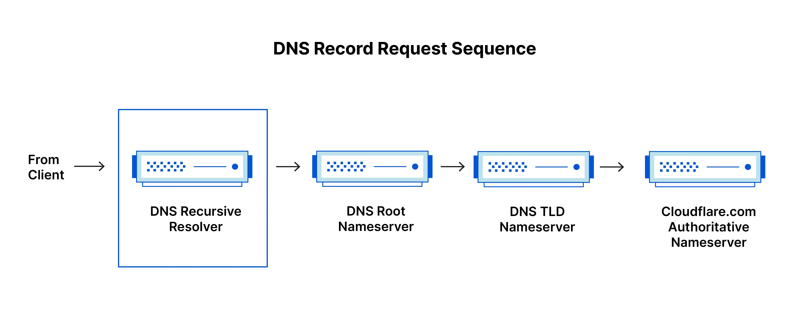
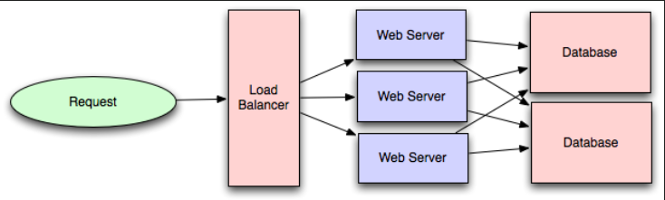
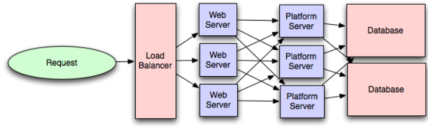
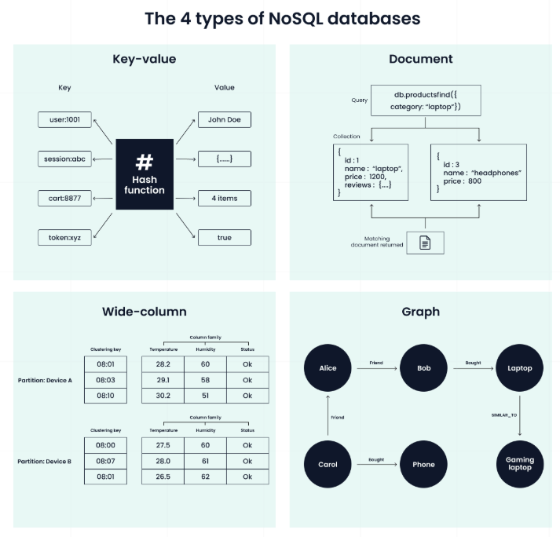
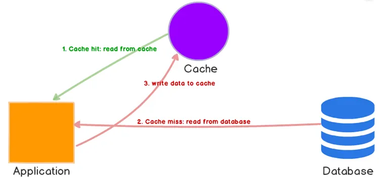
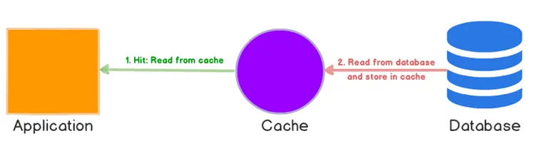
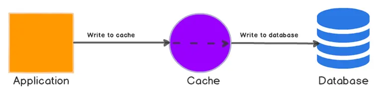
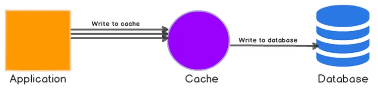
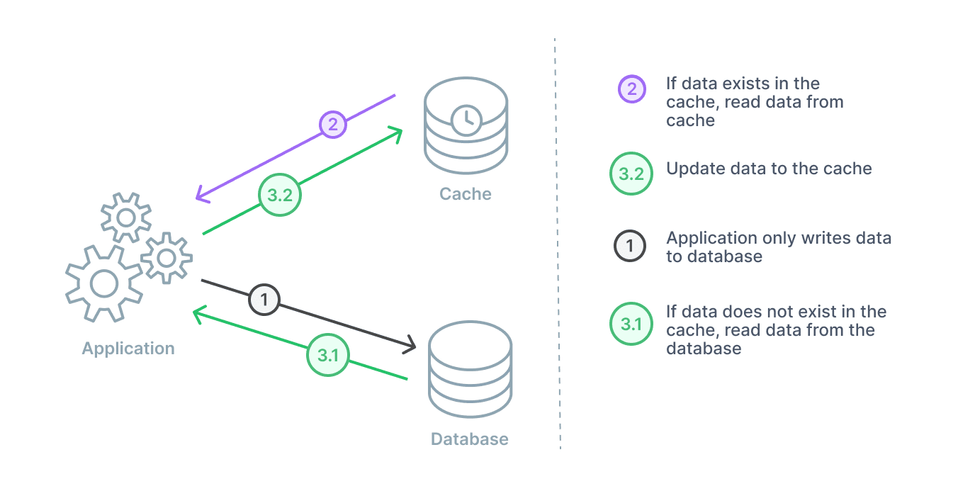

# System Design Introduction
[A good chinese guide](https://github.com/donnemartin/system-design-primer/blob/master/README-zh-Hans.md) on this topic

System design is the process of defining the architecture, components, modules, and data flow of a system to satisfy a set of requirements

the system design process
- Step 1: Constraints and use cases  
- Step 2: Abstract design  
- Step 3: Understanding bottlenecks  
- Step 4: Scaling your abstract design

basic concepts
- Horizontal and Vertical Scaling
- Redundancy and Replication
- Microservices Architecture
- CAP Theorem
- Proxy Servers
- Message Queues
- File Systems

System Design Architecture and Patterns
- Two-Phase Commit (2PC)
- Replicated Load-Balanced Services (RLBS)
- Command and Query Responsibility Segregation (CQRS)
- Saga
- Sharded Services

Tools and Techniques of System Design
- Data Flow Diagrams (DFD)
- Architecture Diagrams
- Data Dictionaries
- Decision Trees
- Decision Tables
- Pseudocode
- Unified Modelling Language (UML)
- API and Contracts

How to approach System Design? 1. **澄清需求与约束**:功能需求 + 非功能需求 (QPS、延迟、数据量、一致性要求、预算)
2. **规模估算**:QPS、存储、带宽 (back-of-the-envelope)
3. **高层设计**:画架构图 —— 客户端 / CDN / LB / API 网关 / 服务 / 缓存 / 数据库 / 消息队列
4. **深入关键组件**:数据库选型与分片、缓存策略、一致性模型、索引 5. **找瓶颈并扩展**:识别单点与热 key,做水平扩展 / 复制 / 分片
6. **明确取舍**:说清每个选择放弃了什么 (CAP、延迟 vs 吞吐、成本)

# CAP Theorem

CAP 只在分区发生期间成立。

CAP Theorem: 分布式系统中 **一致性 (Consistency)**、**可用性 (Availability)**、**分区容错性 (Partition Tolerance)** 三者最多同时满足两个。

网络分区必然发生,故 P 必选,实际取舍在 C 与 A 之间。


## CP (Consistency + Partition Tolerance)
分区时优先保证一致性:宁可拒绝或阻塞请求,也不返回过期数据。
- 适用:支付、转账、分布式锁、配置中心
- 代表:ZooKeeper、etcd、HBase

## AP (Availability + Partition Tolerance)
分区时优先保证可用性:每个节点照常响应,可能返回旧数据,分区恢复后再同步解决冲突。
- 适用:社交信息流、商品列表、购物车
- 代表:Cassandra、DynamoDB、Eureka

## Performance vs Scalability
- **Performance (性能)**:单个请求处理多快
- **Scalability (可扩展性)**:增加资源时性能能否随之提升
- 二者独立:可性能好但不可扩展(单机 MySQL);也可可扩展但性能差(多跳微服务调用链)

## Latency vs Throughput
- **Latency (延迟)**:完成单次request所需时间 (ms) 
- **Throughput (吞吐量)**:单位时间处理的request数 (QPS/RPS) 
- 常需权衡:批处理提升吞吐但拉高单次延迟;

goal: **在可接受延迟下最大化吞吐**

## Availability vs Consistency
- **一致性**:所有节点读到同一份最新数据
- **可用性**:每个请求都能获得非错误响应

强一致需等副本同步,牺牲可用性;

高可用则允许读到短暂过期数据 —— 即 CAP 中 C 与 A 的拉扯

## Consistency Patterns

有同一份数据的多份副本，我们面临着怎样同步它们的选择，以便让客户端有一致的显示数据。回想CAP 理论中的一致性定义 - 每次访问都能获得最新数据但可能会收到错误响应

### 弱一致性

在写入之后，访问可能看到，也可能看不到（写入数据）。尽力优化之让其能访问最新数据。

这种方式可以 memcached 等系统中看到。弱一致性在 VoIP，视频聊天和实时多人游戏中等真实实例中表现不错。打个比方，如果你在通话中丢失信号几秒钟时间，当重新连接时你是听不到这几秒钟所说的话的。

### 最终一致性

在写入后，访问最终能看到写入数据（通常在数毫秒内）。数据被异步复制。
DNS 和 email 等系统使用的是此种方式。最终一致性在高可用性系统中效果不错。

### 强一致性

在写入后，访问立即可见。数据被同步复制。

文件系统和关系型数据库（RDBMS）中使用的是此种方式。强一致性在需要记录的系统中运作良好。

## Availability Patterns

### Fail-Over（故障转移）

**定义**：当系统中的一个节点（服务器/数据库）发生故障时，自动将流量或工作负载切换到备用节点，以保证服务不中断。图片中给出了两种常见的节点部署模式：

#### 1. Active-Passive（主备模式 / 活动-待机）
*   **工作方式**：只有主节点（Active）对外提供服务，备用节点（Passive）处于待命状态，实时同步主节点的数据。
*   **故障切换（Fail-Over）**：当主节点宕机，负载均衡器或心跳检测机制会检测到故障，并将备用节点提升为新的主节点，接管所有流量。
*   **优点**：数据一致性强（可以同步复制），架构简单。
*   **缺点**：资源浪费（备用节点平时不干活）；切换过程中可能出现短暂的服务中断。
*   **场景**：传统关系型数据库主库、核心支付系统。

#### 2. Active-Active（双活模式 / 活动-活动）
*   **工作方式**：两个或多个节点同时对外提供服务（通常通过 **Load Balancing** 负载均衡分发流量）。它们互为备份。
*   **故障切换（Fail-Over）**：当一个节点宕机，负载均衡器自动将原本发给它的流量分发给其他存活节点。
*   **优点**：资源利用率高（没有闲置机器）；吞吐量高；切换速度快。
*   **缺点**：架构复杂，最难的是**数据同步**（容易产生冲突），通常需要配合最终一致性或复杂的分布式共识算法。
*   **场景**：Web 服务器集群、微服务架构。

### Replication

**定义**：为了保证数据不丢失和高可用，通常需要把数据复制到多个节点上。图片列出了两种主要的数据库复制架构：

#### 1. Master-Slave（主从复制）
*   **工作方式**：一个主节点（Master）负责处理写操作（Write），多个从节点（Slave）从主节点同步数据，只负责处理读操作（Read）。
*   **故障处理**：如果主节点宕机，需要手动或自动（如使用 Sentinel、Proxy）将一个从节点提升（Promote）为新的主节点。这本质上是结合了 Active-Passive 的 Fail-Over 机制。
*   **优点**：**读扩展性极好**（可以把大量读请求分摊给从节点）；数据备份方便。
*   **缺点**：写操作仍是单点瓶颈；从节点有复制延迟（容易读到旧数据，即最终一致性）。
*   **场景**：读多写少的业务，如新闻网站、内容管理系统。

#### 2. Master-Master（双主 / 主主复制）
*   **工作方式**：两个或多个节点都可以处理写操作，互为主从，相互同步数据。
*   **故障处理**：任何一台宕机，另一台可以继续提供读写服务，实现真正的 Active-Active。
*   **优点**：写操作也可以水平扩展；可用性极高。
*   **缺点**：**写冲突（Write Conflict）是噩梦**。如果两个节点同时修改同一条数据，必须制定复杂的冲突解决策略（如时间戳、版本号，甚至人工介入）。一致性极难保证。
*   **场景**：多数据中心部署，跨地域高可用系统。

在实际系统设计中，它们通常是交叉使用的：
*   前端 Web 层通常用 **Active-Active + Load Balancing**（无状态，容易扩展）。
*   后端数据库层通常用 **Master-Slave + Fail-Over**（保证数据一致性，读扩展）。

#### 3. No-leader Architecture

客户端可以并行地向多个节点发送写入请求，并从多个节点读取数据。

无主节点复制可以提供高可用性和容错能力以及高读写吞吐量。

**缺点**：很难确保所有节点始终拥有相同的数据视图, 处理并发写入可能引发的冲突也十分复杂，需要精心设计以确保数据一致性。

# availability in numbers

noting time: 2026-10-10

[availability in numbers post](https://www.enjoyalgorithms.com/blog/availability-system-design-concept)

availability is the ability that a system remian operational despite failure within its components

**the nine`s of availability**:

availability = uptime / (uptime + dowmtime)

<table style="border-collapse: collapse; width: 100%; font-family: Arial, sans-serif; font-size: 14px; color: #333;">
  <thead>
    <tr>
      <th style="border: 1px solid #b0b0b0; padding: 10px 15px; text-align: center; vertical-align: middle; background-color: #fdf3d0; font-weight: bold;">Availability %</th>
      <th style="border: 1px solid #b0b0b0; padding: 10px 15px; text-align: center; vertical-align: middle; background-color: #fdf3d0; font-weight: bold;">Downtime/Year</th>
      <th style="border: 1px solid #b0b0b0; padding: 10px 15px; text-align: center; vertical-align: middle; background-color: #fdf3d0; font-weight: bold;">Downtime/Month</th>
      <th style="border: 1px solid #b0b0b0; padding: 10px 15px; text-align: center; vertical-align: middle; background-color: #fdf3d0; font-weight: bold;">Downtime/Week</th>
    </tr>
  </thead>
  <tbody>
    <tr>
      <td style="border: 1px solid #b0b0b0; padding: 10px 15px; text-align: center; vertical-align: middle; background-color: #dbfad9;">90% (one nine)</td>
      <td style="border: 1px solid #b0b0b0; padding: 10px 15px; text-align: center; vertical-align: middle;">36.53 days</td>
      <td style="border: 1px solid #b0b0b0; padding: 10px 15px; text-align: center; vertical-align: middle;">72 hours</td>
      <td style="border: 1px solid #b0b0b0; padding: 10px 15px; text-align: center; vertical-align: middle;">16.8 hours</td>
    </tr>
    <tr>
      <td style="border: 1px solid #b0b0b0; padding: 10px 15px; text-align: center; vertical-align: middle; background-color: #dbfad9;">99% (two nines)</td>
      <td style="border: 1px solid #b0b0b0; padding: 10px 15px; text-align: center; vertical-align: middle;">3.65 days</td>
      <td style="border: 1px solid #b0b0b0; padding: 10px 15px; text-align: center; vertical-align: middle;">7.20 hours</td>
      <td style="border: 1px solid #b0b0b0; padding: 10px 15px; text-align: center; vertical-align: middle;">1.68 hours</td>
    </tr>
    <tr>
      <td style="border: 1px solid #b0b0b0; padding: 10px 15px; text-align: center; vertical-align: middle; background-color: #dbfad9;">99.9% (three nines)</td>
      <td style="border: 1px solid #b0b0b0; padding: 10px 15px; text-align: center; vertical-align: middle;">8.77 hours</td>
      <td style="border: 1px solid #b0b0b0; padding: 10px 15px; text-align: center; vertical-align: middle;">43.8 minutes</td>
      <td style="border: 1px solid #b0b0b0; padding: 10px 15px; text-align: center; vertical-align: middle;">10.1 minutes</td>
    </tr>
    <tr>
      <td style="border: 1px solid #b0b0b0; padding: 10px 15px; text-align: center; vertical-align: middle; background-color: #dbfad9;">99.99% (four nines)</td>
      <td style="border: 1px solid #b0b0b0; padding: 10px 15px; text-align: center; vertical-align: middle;">52.6 minutes</td>
      <td style="border: 1px solid #b0b0b0; padding: 10px 15px; text-align: center; vertical-align: middle;">4.32 minutes</td>
      <td style="border: 1px solid #b0b0b0; padding: 10px 15px; text-align: center; vertical-align: middle;">1.01 minutes</td>
    </tr>
    <tr>
      <td style="border: 1px solid #b0b0b0; padding: 10px 15px; text-align: center; vertical-align: middle; background-color: #dbfad9;">99.999% (five nines)</td>
      <td style="border: 1px solid #b0b0b0; padding: 10px 15px; text-align: center; vertical-align: middle;">5.25 minutes</td>
      <td style="border: 1px solid #b0b0b0; padding: 10px 15px; text-align: center; vertical-align: middle;">25.9 seconds</td>
      <td style="border: 1px solid #b0b0b0; padding: 10px 15px; text-align: center; vertical-align: middle;">6.05 seconds</td>
    </tr>
    <tr>
      <td style="border: 1px solid #b0b0b0; padding: 10px 15px; text-align: center; vertical-align: middle; background-color: #dbfad9;">99.9999% (six nines)</td>
      <td style="border: 1px solid #b0b0b0; padding: 10px 15px; text-align: center; vertical-align: middle;">31.56 seconds</td>
      <td style="border: 1px solid #b0b0b0; padding: 10px 15px; text-align: center; vertical-align: middle;">2.59 seconds</td>
      <td style="border: 1px solid #b0b0b0; padding: 10px 15px; text-align: center; vertical-align: middle;">604.8 milliseconds</td>
    </tr>
    <tr>
      <td style="border: 1px solid #b0b0b0; padding: 10px 15px; text-align: center; vertical-align: middle; background-color: #dbfad9;">99.99999% (seven nines)</td>
      <td style="border: 1px solid #b0b0b0; padding: 10px 15px; text-align: center; vertical-align: middle;">3.15 seconds</td>
      <td style="border: 1px solid #b0b0b0; padding: 10px 15px; text-align: center; vertical-align: middle;">263 milliseconds</td>
      <td style="border: 1px solid #b0b0b0; padding: 10px 15px; text-align: center; vertical-align: middle;">60.5 milliseconds</td>
    </tr>
    <tr>
      <td style="border: 1px solid #b0b0b0; padding: 10px 15px; text-align: center; vertical-align: middle; background-color: #dbfad9;">99.999999% (eight nines)</td>
      <td style="border: 1px solid #b0b0b0; padding: 10px 15px; text-align: center; vertical-align: middle;">315.6 milliseconds</td>
      <td style="border: 1px solid #b0b0b0; padding: 10px 15px; text-align: center; vertical-align: middle;">26.3 milliseconds</td>
      <td style="border: 1px solid #b0b0b0; padding: 10px 15px; text-align: center; vertical-align: middle;">6 milliseconds</td>
    </tr>
    <tr>
      <td style="border: 1px solid #b0b0b0; padding: 10px 15px; text-align: center; vertical-align: middle; background-color: #dbfad9;">99.9999999% (nine nines)</td>
      <td style="border: 1px solid #b0b0b0; padding: 10px 15px; text-align: center; vertical-align: middle;">31.6 milliseconds</td>
      <td style="border: 1px solid #b0b0b0; padding: 10px 15px; text-align: center; vertical-align: middle;">2.6 milliseconds</td>
      <td style="border: 1px solid #b0b0b0; padding: 10px 15px; text-align: center; vertical-align: middle;">.6 milliseconds</td>
    </tr>
  </tbody>
</table>

## how to achieve high availability

- Passive Redundancy: Only some of the components are active at any given time and backup components are available in case of a failure.

- Active Redundancy: Multiple active components work simultaneously to perform the task.

redundancy alone **isn`t enough** to guarantee availability

some other strategies:

- use load balancer to prevent server overloading
- if possible, implement mechanism for automatic failover
- replicate multiple locations to avood outages and make system resilient against disasters

# Basic Concepts

## background jobs

Definition: Tasks that run asynchronously outside the main request-response cycle- 

Purpose: Prevent UI blocking, handle heavy processing, and improve system responsiveness-

- Characteristics:
  - Run in the background (server-side workers, queues)-
  - No immediate user interaction required-
  - Can be long-running or resource-intensive-
- Common Use Cases:
  - Sending bulk emails or notifications-
  - Video/image processing and encoding-
  - Generating large reports or PDFs-
  - Data synchronization between systems-


### Event-Driven Triggers

Definition: Jobs that are triggered by a specific action, state change, or system event-

- How it works: A producer emits an event → a consumer picks it up and runs the job-
- Examples:
  - User uploads a file → trigger thumbnail generation-
  - New row inserted in DB → trigger data sync to a warehouse-
  - Payment completed → trigger invoice generation-
  - HTTP Webhook received → trigger external API call-
- Pros: Real-time, highly scalable, decoupled architecture-
- Cons: Can be harder to debug and trace (event chains)-

###  Scheduled—Driven Triggers (Cron Jobs)

Definition: Jobs that run based on a specific time or interval.

- How it works: A scheduler (e.g., cron, systemd timers, AWS EventBridge) fires the job at predefined times.
- Examples:
  - Every night at 2:00 AM → database backup.
  - Every 5 minutes → check for stale sessions.
  - Every Monday at 9:00 AM → send weekly digest emails.
- Pros: Predictable, easy to implement, great for batch processing.
- Cons: Not real—time; can cause resource spikes if many jobs run simultaneously.

## DNS
Domain name system
- Dns recursor
- root namesever
- TLD namesever: the top level domain server
- Authoritative namesever



there are also caches tp speed up

## CDN

内容分发网络（CDN）是一个全球性的代理服务器分布式网络，它从靠近用户的位置提供内容。通常，HTML/CSS/JS，图片和视频等静态内容由 CDN 提供，虽然亚马逊 CloudFront 等也支持动态内容。CDN 的 DNS 解析会告知客户端连接哪台服务器。

将内容存储在 CDN 上可以从两个方面来提供性能：
- 从靠近用户的数据中心提供资源
- 通过 CDN 你的服务器不必真的处理请求

### CDN push

当你服务器上内容发生变动时，推送 CDN 接受新内容。直接推送给 CDN 并重写 URL 地址以指向你的内容的 CDN 地址。你可以配置内容到期时间及何时更新。内容只有在更改或新增是才推送，流量最小化，但储存最大化。

### CDN pull

CDN 拉取是当第一个用户请求该资源时，从服务器上拉取资源。你将内容留在自己的服务器上并重写 URL 指向 CDN 地址。直到内容被缓存在 CDN 上为止，这样请求只会更慢，

*存活时间 (TTL)* 决定缓存多长时间。CDN 拉取方式最小化 CDN 上的储存空间，但如果过期文件并在实际更改之前被拉取，则会导致冗余的流量。

高流量站点使用 CDN 拉取效果不错，因为只有最近请求的内容保存在 CDN 中，流量才能更平衡地分散。

### cons: CDN

- CDN 成本可能因流量而异，可能在权衡之后你将不会使用 CDN。
- 如果在 TTL 过期之前更新内容，CDN 缓存内容可能会过时。
- CDN 需要更改静态内容的 URL 地址以指向 CDN。

## reverse server
*反向代理*(reverse server)接收来自客户端的请求，将其转发给能够满足该请求的服务器，并将服务器的响应返回给客户端。

负载均衡器只有在拥有*多台服务器*时才有意义，而即使只有一台 Web 服务器或应用服务器，部署反向代理通常也是明智之举。

反向代理的优势
- 安全性更高。 后端服务器信息不会对外暴露，因此恶意客户端无法直接访问它们来利用任何漏洞。
- 更高的可扩展性和灵活性。 由于客户端只能看到反向代理的 IP 地址，您可以自由地更改后端基础架构的配置。 
- Web 加速。 反向代理可以通过 SSL 加速 、 智能压缩和缓存等技术， 缩短生成响应并将其返回给客户端所需的时间，从而提升性能。

许多反向代理服务器都包含一些功能，可以帮助保护后端服务器免受*[分布式拒绝服务 (DDoS) 攻击](https://www.f5.com/glossary/distributed-denial-of-service-ddos-attack)*

## DDos

**DDoS** 全称是 **Distributed Denial of Service**，中文叫 **分布式拒绝服务攻击**。

**攻击者控制大量分散的机器（僵尸网络），同时向目标服务器或网络发送海量请求，耗尽它的带宽、连接数或计算资源，让正常用户无法访问。**

DDoS 之所以叫“分布式”，是因为攻击流量来自全球各地被控制的设备，比如被感染的电脑、服务器、摄像头、路由器等物联网设备, 这些被控制的设备组成的网络叫 **僵尸网络（Botnet）**。

### DDoS 的攻击层次

#### Network Layer Attack(L3/L4)

针对网络基础设施，目的是**堵满带宽**或**耗尽连接资源**。

常见类型：

- **UDP Flood**：发送大量 UDP 包。
- **ICMP Flood**：大量 ping 请求。
- **SYN Flood**：利用 TCP 三次握手，发送大量 SYN 包但不完成握手，耗尽服务器连接表。
- **反射放大攻击**：伪造源 IP，向 DNS、NTP、Memcached 等服务器发请求，让它们把大流量反射给受害者。放大倍数可能几十到几万倍。

特点：流量巨大，容易打满带宽。

#### Application Layer Attack(L7)

针对 Web 应用，模拟正常用户请求，但请求量极大或极其消耗资源。

常见类型：

- **HTTP Flood**：大量 GET/POST 请求。
- **Slowloris**：慢慢发送 HTTP 头，长期占用连接。
- **CC 攻击**：针对动态页面、搜索、登录等消耗数据库的操作。

特点：流量不一定大，但很消耗 CPU、数据库、内存。

## Load Balancer

[*负载均衡器*(Load Balancer)](https://www.f5.com/glossary/load-balancer.html)将传入的客户端请求分配到一组服务器上，以确保令人满意的速度和最佳的运行性能。



### Load Balancer Algorithms

**动态负载均衡算法**

*   **最少连接 (Least connection)：** 检查当前哪个服务器打开的连接数最少，并将流量发送给这些服务器。这假设所有连接需要的处理能力大致相同。
*   **加权最少连接 (Weighted least connection)：** 允许管理员为每台服务器分配不同的权重，假设某些服务器比其他服务器能处理更多的连接。
*   **加权响应时间 (Weighted response time)：** 计算每台服务器的平均响应时间，并将其与每台服务器当前打开的连接数结合起来，以决定将流量发送到哪里。通过将流量发送到响应时间最快的服务器，该算法确保为用户提供更快的服务。
*   **基于资源 (Resource-based)：** 根据每台服务器当时可用的资源来分配负载。在每台服务器上运行的专用软件（称为“代理”）会测量该服务器可用的 CPU 和内存，负载均衡器在将流量分配给该服务器之前会查询该代理。

**静态负载均衡算法**

*   **轮询 (Round robin)：** 轮询负载均衡使用域名系统 (DNS) 将流量轮流分发到服务器列表。权威名称服务器会为一个域保存一个不同的 A 记录列表，并在每次 DNS 查询时提供一个不同的记录作为响应。
*   **加权轮询 (Weighted round robin)：** 允许管理员为每台服务器分配不同的权重。被认为能够处理更多流量的服务器将获得稍微多一点（的流量）。权重可以在 DNS 记录中配置。
*   **IP 哈希 (IP hash)：** 结合传入流量的源 IP 地址和目标 IP 地址，并使用数学函数将其转换为哈希值。根据该哈希值，连接被分配给特定的服务器。

*(注：你输入的“output 他和”应该是“output 它和”或“output 它的中文”的笔误，这里我为你提供了提取的英文原文及对应的中文翻译。)*


### Layer four and Layer seven balancing

| 维度 | L4 负载均衡 | L7 负载均衡 |
|---|---|---|
| **OSI 层级** | 传输层（TCP/UDP） | 应用层（HTTP/HTTPS） |
| **转发依据** | IP + 端口 | URL、Header、Cookie、内容 |
| **是否解析内容** | 否 | 是 |
| **速度** | 极快 | 较快，但有解析开销 |
| **吞吐量** | 极高 | 高 |
| **SSL 终止** | 通常不处理 | 支持 |
| **缓存** | 不支持 | 支持 |
| **智能路由** | 不支持 | 支持 |
| **适用协议** | 任意 TCP/UDP | HTTP/HTTPS、gRPC |
| **典型工具** | LVS、HAProxy (TCP)、NLB | Nginx、Envoy、ALB |

用 L4 的场景
- 需要极高性能和低延迟。
- 非 HTTP 协议：数据库、Redis、MQ、游戏服务器。
- 简单的 TCP/UDP 转发。
- 不想暴露后端架构。

用 L7 的场景
- Web 应用、API 网关。
- 需要根据 URL 或 Header 路由。
- 需要 SSL 终止、WAF、缓存。
- 微服务架构中的 API Gateway。
- 灰度发布、A/B 测试。

实际架构中常组合使用: L4 负责扛住流量洪峰，L7 负责精细化路由。

```text
客户端
  ↓
L4 负载均衡（LVS / NLB）  ← 抗海量流量，隐藏后端
  ↓
L7 负载均衡（Nginx / Envoy） ← 智能路由，SSL 终止
  ↓
后端服务器集群
```

## Platform Layer

大多数应用程序最初都是通过 Web 应用程序直接与数据库通信。

然而添加平台层也有一些令人信服的理由，这样 Web 应用程序就可以与平台层通信，而平台层最终再与数据库通信。



Platform Layer Pros:
- Easier scaling
- High availability
- Cost optimization
- Simplified operations

# Microservice

**微服务（Microservice）** 是一种软件架构风格：把一个大型应用拆分成一组**小型、独立部署、围绕业务能力构建**的服务。每个服务运行在自己的进程中，拥有自己的数据存储，通过轻量级通信机制（如 HTTP/REST、gRPC、消息队列）互相协作。

### Compare to Sigle Architecture

| 维度 | 单体架构 | 微服务架构 |
|---|---|---|
| 部署 | 整体部署 | 每个服务独立部署 |
| 扩展 | 整体扩展 | 按需扩展单个服务 |
| 技术栈 | 统一 | 可异构 |
| 数据库 | 通常共享 | 每个服务独立 |
| 故障影响 | 一处挂可能全挂 | 故障隔离 |
| 开发团队 | 大团队协作难 | 小团队自治 |
| 复杂度 | 低（初期） | 高（分布式） |
| 运维 | 简单 | 复杂，需平台支持 |

### pros

- 独立开发、部署、扩展
- 故障隔离，提高可用性
- 技术栈灵活
- 团队自治，加快迭代
- 易于理解和维护单个服务
- 可按需扩展热点服务

### cons

- 分布式系统复杂：网络延迟、部分失败、重试、幂等
- 数据一致性难：跨服务事务、最终一致性
- 运维监控复杂：日志、链路追踪、服务发现
- 测试困难：集成测试、端到端测试
- 部署和调试成本高
- 需要成熟的 DevOps 和平台层支持

### Classic Components

- **API Gateway**：统一入口，路由、认证、限流
- **服务发现**：如 Consul、Eureka、Kubernetes Service
- **配置中心**：如 Apollo、Nacos
- **负载均衡**：L4/L7
- **消息队列**：Kafka、RabbitMQ
- **容器编排**：Kubernetes
- **可观测性**：Prometheus、Grafana、Jaeger、ELK
- **CI/CD**：GitHub Actions、GitLab CI、Jenkins

这些通常由**平台层**统一提供。

### When to use
 
适合：

- 大型、复杂、长期演进的系统
- 多团队并行开发
- 需要独立扩展不同模块
- 高可用、快速迭代要求高
- 已有 DevOps 和平台层能力

不适合：

- 小项目、初创产品
- 团队规模小、运维能力弱
- 业务逻辑简单、变化不大
- 无法承受分布式复杂性

# Databases

A database is a structured way to store, retrieve, and manage data for an application.
- SQL
- NoSQL

PS: NoSQL stands for "No Only SQL"

Choosing a database involves deciding between relational and non-relational models, and **understanding** how it will *scale*, *replicate*, and *stay consistent* as the application grows.

## Four type of NoSQL Database


### 键值数据库 (Key-Value Databases)
*   **数据模型**：最简单的模型，数据存储为键值对，值可以是任意二进制数据。
*   **工作原理**：数据库不关心值的内部结构，只负责根据键快速存取。它使用哈希表实现**O(1)的查找速度**。
*   **代表**：Redis, Amazon DynamoDB, Memcached。
*   **优点**：**极快**（Redis单节点可达数百万次操作/秒）、模型简单、支持丰富数据结构（如列表、集合）。
*   **适用场景**：缓存、会话管理、实时查找。

### 文档数据库 (Document Databases)
*   **数据模型**：数据以JSON/BSON等文档形式存储，文档内部可以是嵌套的层次结构。
*   **工作原理**：可以直接查询文档内部的任何字段，而不仅仅是主键。支持**多文档ACID事务**（如MongoDB 4.0+）。
*   **代表**：MongoDB, Firestore, CouchDB。
*   **优点**：模式灵活、适合对象式数据、查询能力强。
*   **适用场景**：Web应用后端、内容管理、产品目录。

### 列族数据库 (Wide-Column Databases)
*   **数据模型**：数据按行和列组织，但同一张表中的行可以有不同的列。
*   **工作原理**：使用**分区键**决定数据存储在哪个节点，**聚类键**用于分区内排序。采用LSM树设计，优化写入性能。
*   **代表**：Cassandra, HBase, ScyllaDB。
*   **优点**：为**海量水平扩展**而生，写入性能极高，高可用性。
*   **适用场景**：时序数据、事件日志、IoT传感器数据。

### 图数据库 (Graph Databases)
*   **数据模型**：数据表示为**节点**（实体）和**边**（关系），边有方向和属性。
*   **工作原理**：节点直接存储指向相邻节点的引用，可以高效地**遍历关系**，无需像SQL那样进行多次JOIN。
*   **代表**：Neo4j, Amazon Neptune, JanusGraph。
*   **优点**：擅长处理复杂关系查询、欺诈检测、推荐引擎。
*   **适用场景**：社交网络、推荐系统、知识图谱。

### Comparsion Table

| 对比维度 | 键值数据库 | 文档数据库 | 列族数据库 | 图数据库 |
| :--- | :--- | :--- | :--- | :--- |
| **数据模型** | 键值对 | JSON/BSON文档 | 行与灵活的列 | 节点、边、属性 |
| **查询模型** | 仅按键查询 | 按任意字段查询 | 按分区键和列范围 | 图遍历 |
| **模式** | 无模式 | 灵活（可选验证） | 固定族，灵活列 | 无模式 |
| **最佳场景** | 缓存、会话 | Web后端、目录 | 时序、事件日志 | 欺诈检测、社交 |
| **水平扩展** | 优秀 | 良好 | **优秀**（内置分布式） | 中等（大规模复杂） |
| **ACID事务** | 有限 | 多文档支持 | 有限 | 支持（因实现而异） |
| **代表** | Redis, DynamoDB | MongoDB, Firestore | Cassandra, HBase | Neo4j, Neptune |


### How to Choose
*   **选择键值数据库**：如果访问模式非常简单（如通过已知键获取值），需要**最低的读写延迟**，且数据没有复杂的内部结构需要查询。
*   **选择文档数据库**：如果数据是**自然层次化、对象化**的（如产品属性、用户资料），模式**频繁变化**，且需要**查询文档内部**的字段。
*   **选择列族数据库**：如果需要处理**海量写入**，数据是**时序、事件日志或传感器数据**，且希望有高节点可用性和容错能力。
*   **选择图数据库**：如果**数据点之间的关系**和数据本身一样重要，需要**遍历连接**（如基于购买模式的推荐），且查询涉及**可变深度遍历**（在SQL中需要多次昂贵JOIN）。

## RDBMS（关系型数据库）

传统的关系型数据库（如 MySQL, PostgreSQL, Oracle）强在事务、一致性和复杂查询。但当数据量或并发量达到单机瓶颈时，不能简单地“加机器”，而需要采用以下五种策略：

| 策略 | 核心思想 | 优点 | 缺点 |
| :--- | :--- | :--- | :--- |
| **Replication（复制）** | 将数据同步到多个节点（主从或双主）。 | 读写分离，提高读吞吐量；提供高可用和容灾能力。 | 存在复制延迟（最终一致性）；主库写操作仍是瓶颈。 |
| **Sharding（分片）** | 水平拆分。按规则（如用户ID取模）把数据分散到不同数据库。 | 突破单机存储和性能上限，实现水平扩展。 | 跨分片查询和事务极其复杂，分片扩容困难。 |
| **Federation（联邦）** | 按业务功能拆分。把用户库、订单库、商品库拆成独立的数据库。 | 解耦，按需扩展特定业务，减少单库压力。 | 跨库 JOIN 困难，分布式事务复杂。 |
| **Denormalization（反规范化）** | 为了避免 JOIN，故意引入冗余数据（如把用户名冗余存到订单表）。 | 减少昂贵的 JOIN 操作，大幅提升查询速度。 | 数据冗余，更新时需同步多处，存在数据不一致风险。 |
| **SQL Tuning（SQL 调优）** | 优化索引、重写慢查询、优化执行计划、调整数据库参数。 | 成本最低，见效快，不需要改架构。 | 存在物理极限，无法解决根本性的架构瓶颈。 |

### Comparsion

*   **NoSQL 的思路**：**“天生分布式”**。它牺牲了强一致性（通常遵循 CAP 定理中的 AP 或 CP 权衡），换取了水平扩展的能力。你选 NoSQL，通常是因为你的数据模型不适合用表，或者数据量巨大需要分布式。
*   **RDBMS 的思路**：**“强一致性 + 后期扩展”**。它先保证 ACID 事务，当单机扛不住时，再通过复制、分片、反规范化等复杂手段去“强行”扩展。

**一句话选型建议**：
*   如果你需要**强事务、复杂关联查询**（如金融系统），选 **RDBMS**，并配合调优和垂直扩展。
*   如果你需要**海量数据、灵活模式、极高并发**（如社交动态、物联网），选 **NoSQL**，并接受最终一致性。张图片对比了现代系统设计中**两大数据库阵营**：**NoSQL** 和 **RDBMS（关系型数据库）**，并分别列出了它们最核心的类型或扩展策略。

# Caching

## five caching strategies

### 1. Cache-Aside (旁路缓存 / Lazy Loading)
这是最常用的策略，核心是**按需缓存**。应用程序负责管理缓存，数据仅在**缓存未命中 (Cache Miss)** 时，才从数据库加载并写入缓存。
*   **流程**：应用先查缓存，命中则返回；未命中则查数据库，再将结果写入缓存。
*   **优点**：**高容错性**（缓存故障不影响系统运行）、灵活性高（可缓存任意数据结构）。
*   **缺点**：首次请求有**初始延迟**；缓存失效时可能引发**缓存击穿 (Cache Stampede)** 问题。
*   **适用**：读多写少、对一致性要求不极端的通用场景。



### 2. Read-Through (读穿透)
与 Cache-Aside 类似，但**缓存层本身负责**从数据库加载数据，应用只需与缓存交互。
*   **优点**：简化应用代码，逻辑由缓存层统一处理。
*   **缺点**：实现复杂，需确保缓存平台支持；**难以控制哪些数据被缓存**，可能缓存无用数据。
*   **适用**：读密集型，且希望简化应用逻辑的场景。




### 3. Write-Through (写穿透)
写入时**同步更新缓存和数据库**，两者都成功才算完成。
*   **优点**：**强一致性**，缓存与数据库数据始终保持同步。
*   **缺点**：**写入性能较低**（需等待双重写入）；可能缓存大量**只写不读**的“冷数据”，浪费资源。
*   **适用**：对数据一致性要求极高的场景，如配置管理、参考数据。



### 4. Write-Back (写回 / Write-Behind)
写入时**只更新缓存**，随后**异步地**将数据同步到数据库。
*   **优点**：**写入性能极高**，大幅降低数据库压力。
*   **缺点**：**数据不一致风险**（缓存未同步前，数据库是旧数据）；若缓存故障，**可能丢失未同步的数据**。
*   **适用**：写密集型、能容忍短暂数据不一致的场景，如日志收集、计数器。



### 5. Write-Around (绕写)
写入时**直接写数据库**，**绕过缓存**。仅当后续有读取请求时，才将数据加载到缓存中。
*   **优点**：避免缓存被**只写不读**的数据污染。
*   **缺点**：首次读取数据时会有**缓存未命中**，产生延迟。
*   **适用**：写入频率远高于读取频率的场景。




### Refresh Ahead

Refresh-ahead is a caching strategy where the system automatically refreshes a cached item before it expires, based on predicted access patterns.

### Comparsion Table

| 策略 | 数据一致性 | 写性能 | 读性能 (首次) | 缓存污染风险 | 典型场景 |
| :--- | :--- | :--- | :--- | :--- | :--- |
| **Cache-Aside** | 最终一致 | 中 | 低（有延迟） | 低 | 通用、读多写少 |
| **Read-Through** | 最终一致 | 中 | 低（有延迟） | 中 | 读密集、简化代码 |
| **Write-Through** | **强一致** | **低** | 高 | **高** | 强一致性要求 |
| **Write-Back** | **弱一致** | **高** | 高 | 中 | 写密集、容忍延迟 |
| **Write-Around** | 最终一致 | 高 | 低（有延迟） | 低 | 写多读少 |

## Type of Caching

### Client Caching

Client caching stores data directly on the user's device, such as in a browser cache or local storage

then repeated requests for the same resource do not need to reach the server at all. 

This is the *fastest* form of caching, since it avoids network round trips entirely. 

Cache headers and expiration policies control how long client-cached content stays valid.

### CDN Caching

CDN caching stores *static content*, like images, stylesheets, and scripts, on distributed **edge servers close** to end users.

it reduces the distance data has to travel and offloads traffic from the origin server.

Content can be cached for a set duration or invalidated when it changes.

### Web Server Caching

Web server caching stores responses at the web server level, such as full HTML pages or static resources, so the server can serve them directly without regenerating them for each request. 

### Database Caching

Database caching stores the results of frequent or expensive database queries so they do not need to be recalculated on every request.

Many databases include a built-in caching layer, and applications can also add an external cache in front of the database.

### Application Caching

Application caching stores computed results or frequently used data directly within the application layer, often in memory, to avoid repeating expensive operations.

It can **cache anything** from database query results to rendered page fragments. Because it lives close to the application code, it typically offers very low latency.

基于内存的缓存比如 Memcached 和 Redis 是应用程序和数据存储之间的一种键值存储。由于数据保存在 RAM 中，它比存储在磁盘上的典型数据库要快多了。RAM 比磁盘限制更多，所以例如 [least recently used (LRU)]() 的缓存无效算法可以将「热门数据」放在 RAM 中，而对一些比较「冷门」的数据不做处理。

Redis 有下列附加功能：

* 持久性选项
* 内置数据结构比如有序集合和列表

有多个缓存级别，分为两大类：数据库查询和对象：

* 行级别
* 查询级别
* 完整的可序列化对象
* 完全渲染的 HTML

一般来说，你应该尽量避免基于文件的缓存，因为这使得复制和自动缩放很困难。

### Summary Table

| 缓存类型 | 位置 | 主要作用 | 典型例子 |
|---|---|---|---|
| **Client Caching** | 用户浏览器/App | 本地保存资源，减少网络请求 | 浏览器缓存、LocalStorage |
| **CDN Caching** | 全球边缘节点 | 把静态内容分发到离用户最近的节点 | Cloudflare、CloudFront |
| **Web Server Caching** | Nginx/Apache 等反向代理 | 缓存页面或 API 响应，保护后端 | Nginx proxy_cache |
| **Application Caching** | 应用层专用缓存服务 | 缓存业务数据、查询结果、会话 | Redis、Memcached |
| **Database Caching** | 数据库内部 | 缓存磁盘数据页，减少 I/O | MySQL Buffer Pool |

